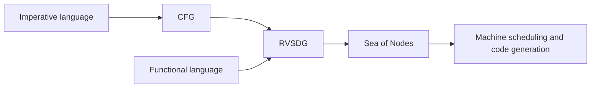
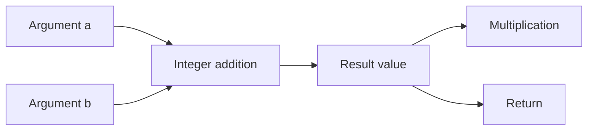
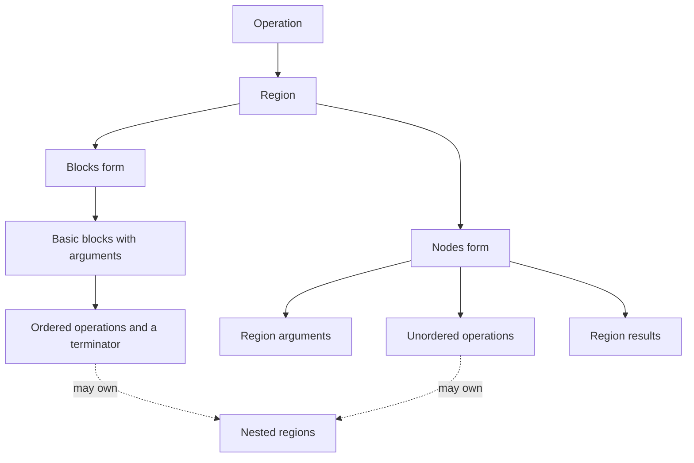
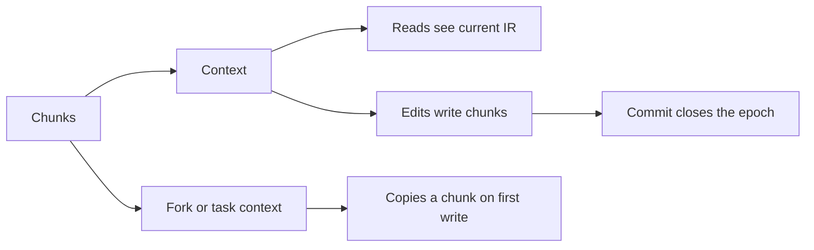

# Core IR

TIR's intermediate representation, or IR, describes a program as operations
connected by values. Operations can contain regions, so the same representation
can express a whole module, a function body, or a single instruction.

The core owns the graph and its editing rules. Dialects define what the
operations and types mean. This separation lets a compiler change the form of a
program without replacing all of its storage, traversal, and analysis machinery.

## Dialects

A dialect groups related operations and types under a name. For example,
`builtin` provides basic arithmetic and types, `func` describes functions and
calls, and `scf` describes structured control flow. Target dialects describe
machine instructions.

A dialect does not own a separate graph. Operations from several dialects can
appear in one function and exchange values. A dialect can also use types defined
by another dialect. Function operations, for example, can accept and return
builtin integer types.

Each operation definition gives the operation a name and describes its operands,
results, attributes, and nested regions. The definition types its operands and
results with a signature scheme, and can also declare interfaces and formal
semantics. Generated builders and accessors give these parts names, such as the
left and right operands of an addition. Custom verification checks rules that
the declaration cannot express.

A scheme is one polymorphic type for the whole operation, written in the
constructors of the term store:

```rust
operation! {
    AddIOp {
        name: "addi",
        dialect: "builtin",
        scheme: "forall W: nat. (int<W>, int<W>) -> int<W>",
        operands: O { lhs, rhs },
        results: R { result },
    }
}
```

The operand and result blocks only name the ports; the scheme types them in
order. `_` is a fresh variable at each position, `T*` a variadic group and `T?`
an optional port. A variable in the last, optional argument of a constructor
also stands for its absence, so `ptr.p<_>` takes an opaque pointer too; a
binder that stands for an absent argument in one value and for a present one
in another does not match. A binder bounded by patterns takes a type of one of
those shapes: `scf.for` counts through `forall C: index | int<_>.`, an index
or an integer. There is no subtyping and no implicit conversion: an `index` is
no integer, and a cast says so.

Verification checks types at commit, a batch at a time: the pass manager
checks the operations a pass edited, and `verify_op_tree` the whole tree. The
check is one join on the relational engine (`core/src/typecheck.rs`). The
batch is loaded as rows: an id per operation, per type its values have and
per other constructor argument, a row per value naming its scheme slot, and a
row per type naming its constructor and argument ids. The op-name table holds
every declared operation's schema from the context's creation, and each
name's scheme compiles once into queries kept there: per slot, the values
whose type has none of the pattern's shapes; per slot reading a bounded
binder, the values binding it to a type of none of its shapes; and per binder
two slots read, the pairs of values that bind it to different ids. A binder
is one query variable wherever it occurs, so the join does the unification.
A failure names the operation and where it came from, the value, both types
after substitution, and the values that bound the variables in it; what the
fitting values bound is asked of the engine only then:

```text
addi at byte 120: operand 2 is !i64, expected !i32; W := 32 from operand 1
```

An operation is located at the byte offset of its text in the source the
parser read. An operation a pass builds is located at its origin: the
rewrite driver locates what it writes for a value at that value's defining
operation, a clone at its source, and anything else at the operation the pass
runs on (`Context::set_origin`).

### Undefined behavior

An operation decides how it is undefined. A `poison:` condition makes its
result poison, deferred undefined behavior: only a use is undefined. `addi`
and `subi` with an `nsw` or `nuw` flag are poison on signed or unsigned
overflow, and shifts by at least the width are poison. A `requires:`
condition is immediate: `divsi` must not run with a zero divisor or on
`MIN / -1`. Both are s-expressions over the operands in the vocabulary of
`sem:`. A pure operation reading poison is poison; a select is poison where
its condition or the arm it takes is, and a branch on poison is undefined, as
in Alive2. `builtin.freeze` gives some value for poison, `builtin.assume`
requires its condition, and a load of memory nothing wrote is poison.

A flag is a fact the result relies on, so forgetting one is always a
refinement. fcc flags its signed `int` and wider additions and subtractions
`nsw`. A rewrite rule that names no flag matches a flagged operation too, and
what it introduces carries none; a flagged and an unflagged operation stay
apart in the e-graph. Selection forgets flags: a flagged operation selects
as the unflagged one does.

`%r = builtin.refine %x, %p` is `%x`, and claims `%p` wherever `%x` is
defined. Verification proves the claim with the solver: wherever `%x` is
defined, `%p` is defined and true. Both are read through the semantics of
the operations computing them, each undefined where its own conditions say,
and only where every gate arm the refinement sits in is the
arm its predicate selects, the arm's ports read as the operands the gate
forwards. A pointer is as wide as the layout in scope says; with no layout
the claim is undecided. A disproven or undecided claim fails verification;
nothing is assumed. A refinement is proved when its operation is written:
made, or its operands, attributes or place changed. The IR store keeps the
row stamp each live refinement was proved at, so verification after a pass
that left it alone asks the solver nothing; a rewrite of the operations
computing the predicate is itself a proved refinement and keeps the predicate
true. The obligation is built from a stack, an operation's operands before
it, not by recursion.
`erase-layout` replaces a refinement by the value it refines; the backend
pipeline runs it ahead of selection, whatever ran before. Selection reads a
`builtin.freeze` as its operand's register (`freeze-copy` in
`core/defs/isel.pdl`): machine values hold no poison.

The `dialect!` declaration lists a dialect's operations and types. An
`operation!` declaration defines an operation. A dialect type is a constructor
of the context's term store with a spelling that parses and prints it; equal
types are one term, so values refer to them by a shared type ID.

Registering a dialect makes its parsers and operation interfaces available in a
context. Text such as `func.call` selects an operation through its dialect and
operation name. A typed operation object is a view of the common IR storage.
Edits through that view affect the same operation that generic graph traversal
sees.

A compiler pass examines or transforms the IR. Interfaces let a pass work with
behavior shared across dialects. A control-flow pass can ask whether an operation
is a terminator. A folding pass can ask whether an operation supports constant
folding. Neither pass needs a list of every dialect's operation names.

Formal semantics describe the computation an operation performs. For example,
integer addition describes its result in terms of its two operands. These
definitions support reasoning about equivalent computations and can supply
constant folding. They complement structural verification, which checks whether
the operation has valid inputs, outputs, and regions.

Maps whose traversal selects a diagnostic use `tir_adt::IndexMap` when the
input walk defines the order. The module symbol table retains first-definition
order, and the parser reports undefined labels and values in first-reference
order.
State-fork and use-list verification check values in first-encounter order.
Lookup-only maps remain `HashMap`. Insertion order is deterministic only when
the input walk is deterministic. The map has no removal, so survivor order
cannot change.

## Proposed flows

The following flows are a proposed organization for compilation. They describe
where each graph form is useful, rather than a required pipeline or a claim that
every transition is implemented.



### Imperative languages: CFG to RVSDG to SoN

A control-flow graph, or CFG, represents execution through basic blocks and
branches. Each block contains an ordered sequence of operations. Branches select
the next block and pass values to its arguments.

This form is a natural first representation for imperative languages. Source
statements have an order, mutable variables change over time, and jumps can
connect distant parts of a function. A frontend can preserve these relationships
while it resolves names, types, and storage.

A Regionalized Value State Dependence Graph, or RVSDG, expresses loops and
conditionals through nested regions. Values cross a region boundary through
inputs and outputs. State dependencies express the order of effects such as
memory access.

The CFG-to-RVSDG transition recovers this structure from branches. It must also
preserve effects before it removes block order. If a store must precede a load,
the resulting graph needs a dependency that preserves that order.

The [RVSDG and control flow chapter](rvsdg.md) describes the implemented
conversion, FCC's use of unordered regions, and reconstruction of machine
blocks after instruction selection.

RVSDG makes the inputs and outputs of a loop or conditional explicit. A
transformation can reason about one region, including the values it carries
between loop iterations, without reconstructing that boundary from jumps.

Sea of Nodes, or SoN, represents data, control, and effect dependencies as graph
edges. The proposed transition to SoN makes execution conditions explicit in the
graph as structured regions are lowered. Operations remain unscheduled where
their dependencies allow freedom. Later scheduling chooses legal blocks and
instruction positions.

The reason for this sequence is to keep useful structure until the compiler no
longer needs it. CFG preserves the frontend's execution order. RVSDG exposes
structured computation. SoN gives later transformations freedom to place work
subject to explicit dependencies.

### Functional languages: RVSDG to SoN

A functional frontend can start with RVSDG when expressions, function inputs,
conditional results, and recursion already provide useful boundaries. There is
no need to introduce a CFG merely to recover those boundaries later.

Pure expressions depend on their inputs. Effects still need state dependencies,
even when the source language is functional. The frontend must also preserve the
language's evaluation rules. A lazy language, for example, cannot treat every
expression as an eagerly evaluated node.

After the frontend makes those rules explicit, this flow joins the same proposed
SoN stage as the imperative flow.

### Graph form and dialect are separate choices

CFG, RVSDG, and SoN describe how a program is organized. A dialect describes the
meaning of its operations. Integer addition can keep its meaning across all
three forms, even when its placement or surrounding control flow changes.

TIR's core distinguishes regions of blocks from regions of unordered nodes.
An unordered region alone does not make a complete RVSDG or SoN. The operations,
region boundaries, and dependencies must express the rules of the chosen form.

## Core IR structures

### Context and identity

A `Context` owns the IR and its registrations. Operations, values, blocks,
regions, and types have IDs that identify them within that context. A handle
combines an entity's identity with access to its context.

Handles read the current state of an entity. Copying a handle does not copy an
operation or preserve an old version of it. An ID from one context is not a
portable reference into an unrelated context.

Types are terms of a store the context owns, `Context::terms()`. A type ID is
the row of its term there, so two equal types have one ID and comparing types
compares IDs. There is no process-wide store: two unrelated contexts number
their types independently. The base constructors and the two state types, `state<memory>` and
`state<fp.env>`, come first in every store, so their IDs are constants. A
dialect's constructor gets its ID in a store when it is first registered there.
Type views take the context: `IntegerType::view(&context, ty)`.

### Operations and values

An operation contains operands, results, attributes, and nested regions. Operands
refer to values that the operation consumes. Results are values that it defines.
Attributes hold information such as a constant literal or a comparison mode.
They do not create value dependencies.

TIR uses static single assignment, or SSA. Each value has one definition and a
type. The definition is either an operation result or an argument supplied at a
block or region boundary. A value can have many uses. If an operation reads a
value twice, those operand positions are two distinct uses.



Types describe values, while attributes describe operations and other IR
entities. A constant, for example, has a literal attribute and produces a typed
result value. Another operation consumes the result through an operand.

An integer type `!i<W>` has any width: the term holds `W` as a 64-bit number,
and `IntegerType` and `APInt` read it whole. 64 bits is the fast path. A `builtin.constant` holds an `Int` when its value is an `i64`
sign-extended to its type, and a `Wide` attribute, the value's 64-bit limbs
least significant first, otherwise; the text prints a `Wide` as its unsigned
decimal value.
`APInt` keeps a value of at most 64 bits in one word and the limbs of a wider
one beside it. The e-graph keeps constants as offsets of a 64-bit carrier, so
a wider constant is a literal node there, and a fold whose result needs more
than one word is not made.

A vector `vector.v<N, T>`, spelled `!vector.vec<8xi32>`, holds `N` lanes of
`T`. A dynamic vector, `!vector.vec<i32>`, has the length `vector.vl`: a
nat term for the lane count the target picks at run time, so the parameters
keep their order whether the length is known or not.

### Named types and layout

A module names a type with `type.def !Name = !body`. The use `!Name` is the
term `type.named<Name, []>`, so two uses are equal by id and the body is never
expanded to compare them. A definition with no body is incomplete and can only
be reached through a pointer. A generic definition binds parameters,
`type.def !List<T: data> = ...`, and `!List<!i32>` keeps its arguments in the
term. The body with the arguments substituted is computed only when a layout
needs it. A type definition is a symbol of the module, spelled with its `!`,
so it never collides with a function or a global. The verifier rejects a
definition outside module scope and a type that holds itself or an incomplete
type by value. `!Name` has the kind of its definition's body: the store
records it when the definition is built. A name with no definition yet is an
incomplete data type. Merging
two modules keeps one definition of a name when both bodies are equal, keeps
the complete one when the other is incomplete (C's compatible types), and
renames the incoming one to `!Name.1` when the bodies differ. Bodies are
compared with the renames already made, so a definition that names a renamed
type is renamed too. The rename rewrites every type the moved ops hold, in
their results, ports, block arguments and attributes, dictionaries and layout
specs included.

A layout is a property of a scope, not of a type. The `layout.spec` attribute
of a scope op holds a `#layout.spec<..>`: options such as `endianness` and
`stack_align`, and entries that give a type, or a pattern such as
`!i<W> = {size = !nat.align_to<W, 8>, abi = !nat.min<!nat.pow2_ceil<W>, 64>}`,
its size and alignments in bits as width terms. A key is a type in the
generic codec, and a name it leaves unbound is a variable of the pattern. A
nested scope's spec overrides its enclosing one entry by entry, and the most
specific matching entry wins. A type with no entry takes its layout from a
definition. A named type uses its definition's own layout region or else its
body's, `layout {packed}` passing the struct constructor's `packed` argument,
and is raised to the definition's `align` either way. The core type
definitions define the rest. Every context builds them once, with the same
`type.def` and op builders a frontend uses (`core/src/dialects/layout/types.rs`):
the constructors `!struct<F, packed: bool = false>`, `!union<F>` and
`!variant<F, tag: data = !i32>` by their names, and `!array<N, T>`, `N`
elements of `T` in a row, each at `T`'s alignment, as a named type no module
needs to define. Each has
a layout region or a body (a union is a variant whose tag takes no room). A
struct or variant region walks its fields with an `scf.ordered_for` over
`0..layout.count`, reading each with `layout.at` and carrying the running
offset and alignment. A constructor argument equal to the default its core
definition gives is left out of the term, so `!struct<F>` and
`!struct<F, false>` are one id. Only the core definitions may use a name
spelled like a constructor or one of their own types. The interpreter runs a
layout region with the spec and the type's arguments. The region places each
field with `layout.field` and ends with `layout.result`. A type that none of
these cover has no layout. The context keeps the layouts under each op carrying a
spec until the module's own partition is next edited, so a fold finds them by
that op and asks the region once per type. A query first lays out, from a
stack, what the type holds by value, innermost first, so the regions it runs
find their parts known however deeply types nest. A type asked for again
while its own layout is computed holds itself by value and has no layout.

`layout.sizeof`, `layout.alignof` and `layout.offsetof` ask for a layout in
the IR. Each folds to a constant under the spec in scope through its
`ConstantFold`. `DataLayout` answers the same questions for Rust code.
`ptr.field` names a field's address and `ptr.copy` a copy of one value of a
type. The `erase-layout` pass applies the PDL rules of `core/defs/layout.pdl`,
which rewrite them into `ptr.ptradd` of the field's offset and `ptr.memcpy` of
the type's size. The rules ask the offset and size of the layout in scope
while they rewrite (`offsetof` and `sizeof` in PDL, host calls like a pointer's
width), so what they write is byte constants. Its rules lower what they
match: the shared driver never extracts a node a rule's root matches, and its
commit rewires only the ops a root names, each over the values it read, and
erases each it leaves unread. A function whose partitions' name column holds
no such op is not seeded at all. A frontend runs it right after
`restructure-nodes`; FCC emits one definition per C record and reads every
size and field offset back from `DataLayout`.

### Regions and blocks

Regions give operations nested bodies. A function owns its body region. A
conditional can own regions for its alternatives, and a loop can own a region
for its body. This creates a containment tree alongside the value dependency
graph.



A region has one of these forms at a time. In the blocks form, the entry block
provides the region's arguments. Terminators express control flow between
blocks or back to the enclosing operation. Block arguments receive values from
the incoming control-flow edges.

In the nodes form, the region has its own arguments, also called ports, and an
explicit list of results. Its operations have no execution order implied by
their position in storage. Value and state dependencies constrain execution.

The enclosing operation defines how its operands and results connect to its
regions. A loop, for example, relates initial values, body arguments, values
carried to the next iteration, and final results. Changing one of these lists
can require changes to the others.

### State dependencies

Ordinary values express data dependencies. State values express dependencies on
an effectful resource, such as memory. An operation that changes memory consumes
an incoming state and produces an outgoing state. A later access can depend on
that outgoing state.

This is necessary in unordered regions because textual position cannot preserve
memory order. Independent work can remain unordered, but removing a required
state dependency changes the program. State splits and joins must preserve the
resource's rules, including the order between reads and writes.

A `func.call` conservatively accesses memory and the FP environment. A producer
that knows the callee's contract can restrict this with a `resources` list, such
as `resources ["memory"]` for a memory runtime routine. The list must be non-empty and contain
distinct known resource names. The summary must include every resource the callee may
read or change; it is a semantic promise, not an optimization hint.

## Modification APIs and strategies

### Local edits

Typed builders create operations in a context. Placement is a separate choice.
In a block, an edit chooses an instruction position. In an unordered region, an
edit chooses a region and supplies the dependencies that constrain execution.

The context provides operations to change operands and attributes, replace uses,
replace operations, and erase operations. These APIs maintain graph bookkeeping,
including use lists, parent links, and change tracking. A transformation remains
responsible for the meaning of its edit and for compatible types and region
boundaries.

Replacing an operation requires a decision about its results. A replacement with
the same result shape can redirect consumers to corresponding new results. A
rewrite that changes the number or meaning of results needs an explicit mapping.
Some lowerings preserve result identities while transferring their definitions
to new operations.

Region outputs need attention too. A nodes region's result list is separate from
operation operands. Replacing operand uses alone does not update values exported
through that list. Similarly, removing an operation is safe only after its live
results have replacements or no longer escape to consumers.

### Edits to structured regions

An unordered operation belongs in a region where its operands are visible.
Automatic placement can infer that region from the operands, with state operands
constraining placement. An operation with no operands needs an explicit region.
Operands from sibling regions cannot become visible merely by moving their user.

Loops and conditionals have related inputs and outputs across their boundaries.
Port-editing APIs change these related lists together. Adding a loop-carried
value, for example, also needs its initial value, body argument, next-iteration
value, and final result. Treating these as one structural edit avoids a set of
unrelated list changes that happen to agree.

### Whole-region replacement

A change of graph form often replaces most of a region. Staging builds a new
body away from the attached body, then replaces the old contents as one
structural edit. The transformation records how surviving users reach the new
values.

This strategy suits changes such as rebuilding a CFG or converting between
blocks and nodes. Local edits suit small rewrites whose surrounding structure
stays useful. Staging avoids repeatedly exposing a half-rebuilt region to
traversal and analysis.

### Storage

The IR is stored as relations over four ID spaces: operations, values, regions,
and blocks. An ID is the position of a row. IDs are minted once and never reused.
Inside a function a later ID is larger than an earlier one, and larger than every
module-level ID that existed when it was minted.

Each ID space is cut into chunks of 4096 rows. A chunk holds its rows as columns.
A fact with one value per entity is a positional column: an operation's name, its
holder, and its position there; a value's type and definition; a region's parent
operation. A list an entity owns is a clustered table stored in the owner's chunk,
sorted by owner, with an offset per owner: operands, results, and regions of an
operation; ports and results of a region; arguments of a block. Reading one is an
offset load and a slice.

Every other access path is derived from those rows. Use lists are operand rows
grouped by value, and the regions that publish a value are region result rows
grouped the same way. The operations of a block or unordered region are operation
rows grouped by holder and ordered by position, and the blocks of a region
likewise. Positions leave gaps, so an insert between two neighbours writes one
row. The groupings are built per partition when first read and brought up to date
from the rows written since. A use list merges the operand rows of the operations
written since into a sorted tail beside its base. A holder's list takes a written
operation out of the list it sat in and puts it where its position says in the
list it sits in now, so an append costs a search of that list and not a pass over
it.

A pass that derives a fact per operation, value, block, or region of one
function keeps it in an `IdMap` or `IdSet`. These are columns indexed by row
position, one vector per chunk the function touches, so a lookup hashes nothing
and iteration is in ID order. An operation's interfaces are found the same way,
through its name column.

Each chunk belongs to one partition. The module is a partition, and a frontend
opens another for each function it builds with `Context::function_scope`.
Everything created inside the scope lands in that function's chunks, so a
function's rows share chunks with no other function's.

### Commit and parallel work

A context reads and edits the chunks directly, and each edit is visible to the
next read through that context. `commit` closes an epoch. It moves no ID.



Chunks are shared by pointer. Forking a context copies the pointers, and a write
to a chunk that another context still reads copies that chunk first. A fork is
therefore an independent trial that its origin can adopt or drop. Each context
belongs to one thread.

A fork, a snapshot, and every task of a parallel epoch share their origin's
type store, so a type interned by any of them has one ID in all of them. The
store takes concurrent interning and never moves a row: a row is written once,
before its ID is handed out, into segments that are never reallocated, so a
reader takes no lock. Interning locks only the lookup shard of the term's
constructor. Telling a state type from a value type compares the ID with the two
state constants and reads no term, and the integers up to 128 bits have IDs
fixed in every store.

Parallel passes run each function in a context of its own over the committed
chunks. A task mints IDs from chunk indices reserved for its place in the epoch,
so two tasks never mint the same ID and the result does not depend on how many
workers ran. The commit takes a chunk whole when one task wrote it and merges row
by row when several did. It rejects two tasks writing the same row. One task's
use replacements are replayed over the rows the others wrote.

Commit is a storage boundary, not proof that a transformation preserved the
program. Each partition counts its edits, which lets analyses detect stale
results, and verification checks graph structure and dialect constraints. The
pass still has to preserve the computation and its effects.
