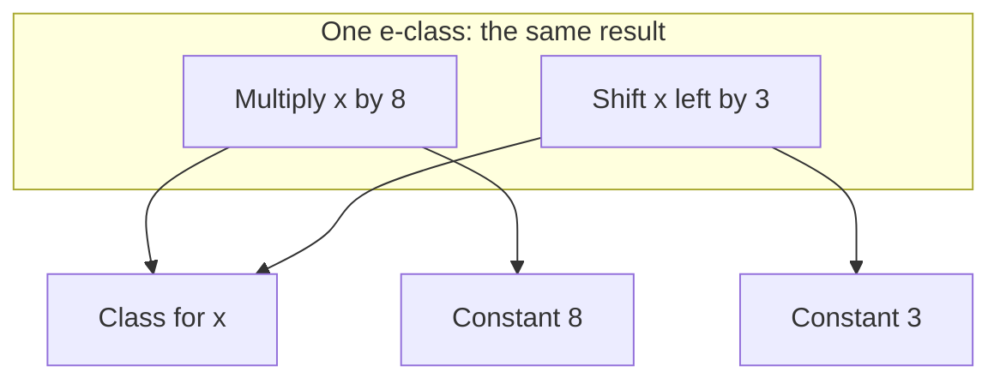
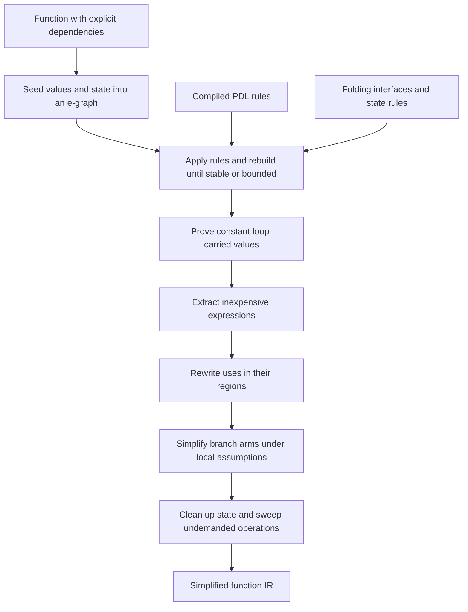
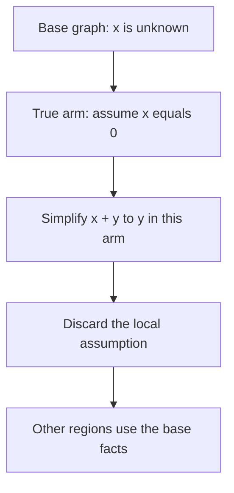

# Instruction combining

Instruction combining simplifies a program's computations before instruction
selection chooses machine instructions. It removes identities such as adding
zero, folds constant expressions, and replaces expensive expressions with
cheaper equivalents. In TIR, it can also use facts from branches, loops, and
memory dependencies.

The name describes the purpose, not a requirement to combine two instructions
into one. A useful result might be an existing value, a constant, or a different
operation. The pass works on compiler IR rather than processor instructions.

TIR's instcombine engine uses an e-graph to retain equivalent expressions until
it chooses a result. [PDL](../pdl/index.md) describes many of the equalities.
The engine supplies the search, cost comparison, control-flow reasoning, and
IR updates that make those rules useful.

## The input and output

An IR operation consumes values and produces results. A region contains
operations, and an operation can contain regions for branch arms or loop
bodies. In an unordered region, dependencies determine execution order.
State values express dependencies between effects, such as a store and a
subsequent load. The [Core IR](core_ir.md) and
[RVSDG and control flow](rvsdg.md) chapters introduce this representation.

Instcombine works on functions in this unordered form. Its output is still
IR in the same form, with uses redirected to simplified values and operations
removed when nothing demands their results or effects. It does not assign
registers or schedule machine instructions.

The pass can run more than once in an optimization pipeline. For example,
inlining can expose constants, and loop transformations can expose address
arithmetic. Each invocation reasons about the function it receives.

## Equivalent expressions share a class

An e-graph stores expressions in equivalence classes, usually called e-classes.
An e-class groups expressions known to produce the same value. An expression
node records an operation and refers to its inputs through other e-classes.
Those input classes can themselves contain several alternatives.

Suppose a rule establishes that multiplication by eight equals a left shift
by three. The graph can retain both forms:



Adding the shift does not immediately delete the multiply. Other rules can
match either form. The engine commits to a representation only when it
extracts an expression from the graph.

Equality also propagates to parents. If two inputs become equivalent, two
otherwise identical operations over those inputs become equivalent too.
This property is called congruence. Rebuilding the graph restores it after
rules merge classes.

A commutative binary operation is a node over the multiset of its two
operands. Its table row is keyed with the lesser operand first, by class and
then by the offset the key keeps, so `a + b` and `b + a` are one row and one
class wherever they come from: the IR, a rule, or a merge that puts a stored
row's operands out of order, which the rebuild re-keys in order again. The
node itself keeps its operands as the operation wrote them, and of two
spellings the graph keeps the first it met.

### Constant offsets are part of identity

The graph refers to a value as a class plus a constant offset, taken modulo
the width of the class's integer or pointer type. `x + 3` is the reference
`(x, 3)` rather than a node of its own, and an integer constant `k` is
`(zero, k)`, where `zero` is the one class for zero of that type. An
operation declares how an offset on an operand reaches its result: addition
passes the offsets of both operands through, subtraction negates the one on
the right, and an operation that declares nothing keeps the operand's offset
as part of its identity, so `f(x + 1)` and `f(x)` stay apart. As a result
`(x + 3) + (y + 5)` and `(x + y) + 8` are one addition node at offset 8, and
`x + 0` is `x` with no node at all.

The union-find stores each class's offset from its representative. A rebuild
carries those offsets into the stored nodes, so merging `y` with `x + 3` also
merges each parent of `y` with the matching parent of `x`, shifted by 3. A
node whose operand becomes a constant this way, such as `x + y` once `y` is
known to be 5, leaves the graph and its class joins `x + 5`. Merging a class
with itself at a different offset is a contradiction, which the engine
records rather than applies.

The offset laws are definitions, not rules. `builtin.addi` and `ptr.ptradd`
declare the `Additive` interface and `builtin.subi` and `ptr.ptrdiff` the
`Subtractive` one, next to `Commutative`; the semantic operators answer from
their kind, with `#neg` and `#not` moving an operand's offset to the result
negated (`not(x + k)` is `not(x) - k`). A node reads its laws once, from the
declaration and from the integer or pointer carrier its type is, so a node a
rule introduces has the same laws as a seeded one. A pointer's carrier is the
data layout's pointer width; with no layout in scope a pointer has none, and
its arithmetic keeps no offsets. The null pointer is the zero of the pointer
carrier, a reference as an integer constant is one of its width's zero, and
the two zeros stay apart.

The graph is not a syntax tree. Different expressions can share inputs, and
equalities can introduce cycles. For example, a loop's carried value can be a
node whose child is its own class. Extraction must find a finite
representation rather than follow that cycle forever.

## From a function to a simplified function

The engine separates discovering alternatives from changing the IR:



### Seeding preserves identity and dependencies

Seeding gives each IR value a reference. A constant is its type's zero at the
constant's value and stores no node. Representable operations become nodes
over the references of their inputs. Operation metadata supplies facts such as
commutativity, offset laws and modeled cost.

The graph also records where a node came from. An existing IR value can often
be reused directly. A rule-created expression needs a way to construct a new
IR operation. A literal needs a constant operation of the appropriate type.
This origin information connects graph exploration to the later IR update.

An operation that the graph cannot represent remains an opaque input. The
engine preserves its identity, so other expressions can refer to it without
assuming anything about its implementation. This allows partial knowledge:
an identity such as `x + 0 = x` does not require understanding how `x` was
computed.

The seeder can also give such a result a row over what its operation reads,
in place of the leaf, for a client that orders effects. The instruction
selector asks for these rows and its chapter describes them. Instcombine
does not. With them every value has a parent in whatever is computed after
it, and the passes that follow a change upward (the delta of a round, the
classes an arm's fact dirties and re-extracts) then reach the rest of the
function: on CoreMark the mid-end ran twice the instructions.

Structured branches contribute conditional values. Loops contribute their
carried inputs, backedges, and published results. Memory accesses contribute
terms tied to the state they observe. These relationships come from the IR's
operation interfaces and dependencies.

What every operation of a kind shares is read once, at the first one seeded:
which of those interfaces the kind has and, per attribute list, the operator
a representable operation becomes, with its laws and cost. An operation then
contributes only its own operands, type and identity. An attribute the
operation's schema does not declare is no part of that identity, so two
operations differing only in such an attribute are one. The pass keeps what was
read beside its vocabulary (`rewrite::Kinds`) and lends it to the seeding of
its next function, as instruction selection does. Whether an operation is
representable depends on its attributes and on the data layout in scope, so a
function under another data layout starts the record again. An attribute list
that is not representable is kept for one function only: it may name what
only that function has, such as a symbol.

The walk follows each region's operation list in position order and enters a
nested region where the operation holding it sits. An operand whose
definition the walk has not reached pulls that definition in first. This
order numbers the classes. A pure operation of a kind already met, with one
result and operands that all have classes, is seeded from its row in the IR
storage. The seeder reads the kind from the name column and the operands and
the result as slices of the operand and result columns. It reads their types
from the value type column and each operand's class from the column the
driver keeps per value. An operand without a class names its definition in
the def column, and a definition that is such a row itself is seeded first,
its value operands ahead of its states, as the walk through a handle would.
No operation handle is made for such a row. The
first operation of a kind in a function goes through its handle, which
fills the kind's facts, and so does an operation with regions, several
results, or an interface the walk branches on.

A pure operation gets its class where the walk meets it and its row later.
The walk asks the engine what the node is over its operands: a reference
its laws settle without a row, as `x + 0` is `x`, or a fresh class at the
offset the node's row is shifted by. Classes are therefore minted in walk
order whichever order the rows are stored in, and the representative of a
set, its lowest class, is the operation the walk met first. The operations
waiting for a row are held per label as columns, one per operand position,
and stored a label at a time when the walk next has to read the partition,
so a batch holds the rows of its label since the last such read. Storing a batch
canonicalizes each row's operands, hashes the keys of the whole batch column
by column and walks the table's index once per key: a key the table holds,
or an earlier row of the batch stored, unites the operation's class with
that row and makes no node, and any other key becomes a row of the class
reserved for it. A row whose key keeps an operand's offset is looked up
alone. Classes reserved for rows that turned out to exist leave gaps in the
class ids.

A row stored before a later batch unites one of its operands names a class
that is no longer a representative, and the equalities that follow from the
merge are not known yet. Gates, loops, memory accesses and joins are
inserted where the walk meets them, over operands whose rows may be waiting.
So before the walk reads the partition (whether a gate's arms agree, whether
a loop carries a port unchanged, whether a join merges one state), the
waiting batches are stored and the graph is rebuilt, and once more when the
walk ends. That rebuild finds the rows stored too early congruent to others.
Such a row's node was stored only because of the order of the batches, so
it leaves its class's node list with its table; of two congruent nodes the
one whose class was minted first stays. The seeded graph then holds the
classes, representatives, rows and node lists that inserting the operations
one at a time in walk order produces.

### Rules discover equalities

The ruleset combines PDL equalities with rules supplied by the host engine.
PDL is useful for local expression patterns:

```pdl
rule mul-one: builtin.muli(x: int<W>, 1) => x;
rule mul-pow2-to-shl:
	builtin.muli(x: int<W>, c: const) => builtin.shli(x, const<W>(ctz(c)))
	where popcount(c) == 1, c != 1;
```

The first rule equates a multiplication by one with its other operand. The
second checks a constant and introduces a shift. A literal or a `const`
operand matches a reference to its carrier's zero and reads the value off its
offset. Neither rule traverses the function or edits users.

Identities the offset laws already give have no rule: `x + 0`, `x - 0`, and
folding the constants of `(x + 3) + 5` into `x + 8`. A pattern naming a
constant operand where an operator's law applies, such as `#add(x, 3)`, never
matches, because no node holds that operand; the PDL compiler rejects it for
a semantic operator, and a generated rule asserts it in a debug build for an
IR one. The
one constant a node keeps there is a zero no identity dissolves, as in
`0 - x`.

Host rules connect matching to behavior that an operation already provides.
Constant folding, for example, asks an operation to compute its result from
constant inputs. Other rules handle known branch decisions and memory state.
The shared engine executes these rules alongside the PDL rules.

### Relational queries drive matching

A compiled pattern is a query over graph nodes and facts about classes.
Each operation in a nested pattern contributes a relation to match. Repeated
binders join those relations through the same class. Guards filter candidate
bindings or compute scalar values needed by the replacement.

For an expression such as `(x + y) - y`, the query joins a subtraction node
to an addition node and requires both appearances of `y` to name the same
class. A successful match can merge the subtraction's class with `x`.

The e-graph (`tir-egraph`) is one client of a generic relational engine
(`tir-relational`) and uses only its public interface. Each label is a
cell of a table keyed by its operands, a pattern node selects the labels it
matches, and a commutative label lets a binary row match with its operands
exchanged: the row stores the pair in key order, and a pattern reads it both
ways. Commutative binary labels have tables of their own, whose key the
relational layer keeps in order when a repair renames a cell. The engine's
union-find keeps each class's offset from its
representative, and a table cell carries a weight beside its class, so a cell
reads as a reference; a table's columns say which operand offsets stay in the
key and which move to the value. Types, and the constants no carrier holds,
are lattice columns over classes. A client declares further columns for
facts of its own (`Engine::add_column`), which a rule reads with a fact atom
and where a class said two different values holds none. A client can also
register tables of its own: relations of 32-bit words, built once, shared with their indexes by
every graph that reads them and never written during saturation. A rule
ranges over one with a table atom that has a term per column. A term that is
a scalar nothing has bound yet is bound to the row's cell; any other term is
computed from the words the match has bound, and the row must hold that value.
An atom with every term bound therefore asks whether a row exists, and one
with some bound yields a match for each row that agrees with them, in the
order the client added the rows. A pattern node can also select every label
of its arity that a predicate of the client accepts, whatever the operator,
and bind the label id of the row it matches to a scalar. One rule then covers
every operator, with a client table keyed by label id saying what each label
means. A graph never renumbers a label, so the table holds for the life of
that graph; the ids are the graph's own, and another graph numbers the same
labels in the order it meets them. The planner places a table atom once
its computed terms can be evaluated and no other atom or guard is left to
bind a scalar it reads, so its rows are looked up under as many columns as
the match can give; atoms that wait for each other go after the row atoms,
the one with most columns bound first. A row atom can hold the tag it binds
to an interval `[lo, hi)` of expressions over scalars (`Rows::tag_within`).
The planner reaches such an atom through its value only once both bounds are
bound, and the atom then reads one slice of a `TagOrder`, the table's rows
sorted by the value's cell and then by tag, instead of every row with that
value. The planner also adds the two comparisons as guards, so an order that
reaches the atom another way reads its rows and the guards filter them. A
negated conjunction goes into the order once every variable it shares with
the query is bound. Placed earlier, it would treat a shared variable the query
binds later as existential and reject a match over a row that names some
other value. The query evaluator, rule actions,
saturation rounds and extraction see only tables, id spaces and lattice
columns; the e-graph compiles its patterns and actions onto them, and keeps
the offset laws to itself: it tells an insert which key a node is stored under
and tells a rebuild which re-keyed rows its laws now settle. When several
atoms of a pattern share an operand none of them has bound yet or reaches its
rows through, the evaluator binds it by intersecting the classes each atom
allows, read from tries of the tables, rather than by probing one atom for
each row of another. The tries hold classes; a match holds the rows to one
reference per operand when it binds them, as the row-by-row search does.
Scalars join the same way. A scalar that a run of consecutive row and table
atoms binds is an attribute of the join beside the operands: a table atom
reads it at a level of a trie over its columns, and the row atom that binds
its label id to it allows the labels its rows have. A table atom leaves
the run when a term of it computes on a scalar the run binds, or reads one a
row atom wrote over. The join runs when the first atom of the run reaches at
least 32 rows; below that each atom probes for the rows under its bound
columns. Both produce the same matches in the same order.

A pattern node that binds its label id to a scalar is held to the client
tables that read the scalar. Where every order a rule is searched in reaches
a table atom after the node, with the scalar as the term of one column, a row
of the node is in a match only if some row of the table holds its label in
that column, beside the literals the atom names in others. What the node
resolves to therefore lists those labels alone, and no graph table all of
whose labels dropped out: a rule over a table that knows three labels tries
rows of those three. The labels are read off a trie of the table when the
rule is resolved, and a label met later is tested when it arrives. A node is
not reduced where another atom or a guard writes the scalar, or where
another node reads the same selection. The reduced selection is kept with
the vocabulary's caches, so the table a rule reads at a slot has to be the
same relation in every graph of the pass.

A search works out a table atom's key columns and the trie over them at its
first lookup, and descends that trie for every lookup after.

A lookup of the rows naming a class, as their value or in an operand
column, passes over the tables that never named it. Each class records the
tables with a row naming it, which a rebuild also reads, and a pattern node
keeps the tables it reads as the same bits: one test of a word settles a
node none of whose tables named the class, and one per table the rest. A
layer's own rows are not recorded, so under an open layer every table is
read. A search from a set of classes first drops the ones no table of the
pattern's root node named, and prepares nothing where none is left.

A search that starts from every row of a pattern node reads the node's tables
grouped by label. A graph's table holds few of the labels a pass has met, so
where the label ids run past eight times the table's rows the grouping is the
rows sorted by label, and no run is laid out per label id.

A search that starts from many rows of one atom first reduces them by the
atoms below it. An atom is below another when its value is one of the other's
operands. For each such atom the evaluator makes one pass over its rows and
marks the classes they are values of, having reduced those rows the same way
by what is below them. A starting row is then tried only if each operand
column holds a marked class, as written or exchanged for a commutative label.
This is the bottom-up half of a semi-join reduction: a row whose operand has
no node of the nested operator costs one bit test instead of a failed descent.
The marks ignore offsets, guards and facts, so they only remove rows that
cannot match, and the matches and their order are those of the unreduced
search. Searches from fewer than 64 rows, and searches under an open layer,
skip the reduction.

The labels the graphs have met, the table each label's rows live in, and
what saturation keeps per rule (what each pattern node resolves to, and which
rules a written cell wakes) belong to no one graph. They form a vocabulary
that the pass owns and lends to each function's engine in turn: the engine is
built over it and hands it back when the function is committed. A label
therefore has one id and one table in every function the pass runs on, a
client table keyed by label ids built when the pass is created stays valid,
and a rule is resolved against a label once per pass. A label can be interned
into the vocabulary before any graph exists. A copy of the pass, which a
parallel pipeline makes per worker each time it runs, is a copy of the pass
as it was added to the pipeline: it has the labels interned by then, none the
original met since, and none of the caches.

A label is the operator, its payload, its result type, its carrier and its
arity. The vocabulary keeps a node without its provenance, which names one
function's IR. An opaque input is one label for every value: which value it
stands for is its node's provenance, and each such node is a class of its
own, never hash-consed. The laws of a label (commutativity, offset
coefficients, identities) are read off the first node interned under it.

A rule that only some graphs call for (a fold per operator, a decided gate
per arity) is compiled at the first function that needs it and kept, so its
plan and the cache of it are one object for the pass. Whether a rule can
match at all is still asked of each graph: a rule whose operator the graph
stores no row of is skipped.

A label's id and its table's slot say in what order the pass met them, so
nothing is read in the order of either. The vocabulary ranks its labels by
their content: operator, attributes by name, arity, payload, type and
carrier, with a type and an attribute name spelled out, since their ids are
the order the context interned them in. A search reads a table's labels by
rank and the tables in the order of what they hold (arity, uniqueness,
offset coefficients), and a rebuild merges the rows that came to share a key
table by table in that order too. The labels a function holds are a subset
of the vocabulary's, and a subset keeps the order of its members, so a
function's matches come in the order they would in a pass that ran it alone.
What the pass makes of a function then depends on neither the functions it
ran before nor how many run at once.

A saturation round searches the current graph, collects matches, applies
their actions, and rebuilds congruence. Later rounds use recorded changes to
restrict searches where a rule's dependencies permit that restriction.
This avoids treating every rule as a fresh whole-function traversal. A table
remembers the last round that wrote one of its rows, so a round lists the new
rows of the tables the round before wrote and of no other, and wakes only the
rules that read a cell of those rows.

A rule the new rows cannot be searched from is searched at the classes near a
change, and a match none of whose rows or facts is new is dropped: the round
before found it. A match is new by a graph row or a fact alone, since no
round writes a client table and an offset or a comparison reads only what is
bound. So where the atoms left of a pattern are table atoms, offsets and
comparisons, a match with nothing new so far is dropped there, before any of
them is looked up. A guard that calls the host is never passed over.

A round's searches read a frozen graph, so they can run at the same time.
The database keeps what a search reads (tables, the partition, lattice
columns, client tables) apart from the indexes it derives on demand. A search
is split in two: preparing it builds every grouping and trie it will read, on
the saturation's thread; running it reads only the core, those indexes and
its own plan's scratch. A client whose guard functions read nothing bound to
one thread says so, and the round then prepares each such rule in rule order,
runs the prepared searches on up to eight threads, one fewer than the
processors it may use (`TIR_SATURATE_THREADS` overrides the count), and puts
each rule's matches back in its place. Actions
are applied afterwards on one thread, a rule at a time in rule order, so the
graph a round produces does not depend on how many threads searched. A thread
is used for every 2048 starting rows, so a small round stays on one. The
instruction selector's rule synthesis runs its pattern rules this way; the
mid-end's guards interpret semantics against the context and stay on the
saturation's thread.

A rule's action runs on all of the rule's matches together, one write after
another: the first write for every match, in match order, then the second.
An insert builds the key of each match's node. The keys of consecutive
matches that fall into one table are looked up as a batch: the key columns
are hashed column by column, each key walks the table's index once, and the
keys the table lacks are appended as rows in match order, each valued with a
new class. Of equal keys in one batch the first makes the class and the rest
find it. A later write reads what an earlier one bound for the same match, so
an insert over a node the action has just made is keyed by the classes the
earlier batch returned. Under a layer the batch is first looked up in the
base and in each lower layer, passing over the rows a layer made stale, and
the keys left go to the layer's own rows through the same lookup. A node its
laws settle, such as a constant or a sum with zero, is a reference and joins
no batch.

Writes are grouped by write and not by match, so an insert sees the merges
of the writes before it for every match and of the writes after it for none.
Two matches can then each make a node that a later merge of the same action
makes congruent, where applying them one after the other would have found
the first node again. The rebuild unites the two. The classes a saturation
proves equal are the same either way; how many e-nodes a class lists, and in
what order, can differ.

Congruence is rebuilt after each rule that merged classes, so the next
rule's inserts are looked up in tables that name representatives. A rebuild
costs what the merges touched. Each class records which tables have a row
naming it, and a merge adds the record of the absorbed class to the
survivor's; the rebuild rewrites only the tables on the records of the
classes absorbed since the last one. When each of those classes was made in
the current round, only rows written in the round can name one, and the
rebuild reads those rows alone. The usual action, which makes a node and
merges it into the class it matched, is thus repaired by rewriting the value
of the row it has just stored. A row stored naming a class that was already
absorbed puts its table on the list in full. Under a layer the rebuild
rewrites the layer's own rows and copies the lower rows naming an absorbed
class, which it finds through an index from classes to the base rows naming
them.

The rounds stop when no further progress is found or when a resource limit
is reached. Bounds on work and graph size keep compilation finite even when
the rules can generate many alternatives. The bound on size is a growth over
the seeded graph, so a large function is searched like a small one. The result therefore contains the
equivalences discovered within the search budget, not every possible identity.

Some rules run in a terminal post-saturation phase. Reassociating a product
of constants is one use: a new constant should not repeatedly feed a cyclic
class and generate more constants in the same saturation call. These rules have the same equality
obligation as ordinary rules; only their scheduling differs.

## Facts that hold only inside a region

A condition can be unknown for the function as a whole but known inside one
of its branch arms. The engine opens an assumption scope for a boolean arm,
equates its predicate with the appropriate truth value, and saturates again.
If the condition establishes an equality between operands, their classes can
also merge inside that scope.

For example, inside the true arm of `x == 0`, an expression `x + y` can simplify
to `y`. That does not establish `x == 0` after the branch or inside its false
arm.



The scoped graph and its extraction results keep these facts local. Values
constructed using an arm's assumptions are not reused as if the assumptions
held everywhere.

## Constant values carried through loops

A loop-carried value receives an initial value on entry and a new value from
each backedge. A constant initial value alone does not make it constant
throughout the loop.

The engine tests that possibility as a hypothesis. It temporarily equates a
candidate carried value with its initial constant, saturates the body under
the hypotheses, and checks every backedge. If a backedge is not equal to the
initial constant, the candidate is removed. The engine repeats with the
remaining candidates until none are refuted.

This is an inductive argument: the value is constant on entry, and the body
preserves that constant on every next iteration. Backedges compare as
references, so a counter's next value, the counter at offset one, refutes the
hypothesis that the counter is its initial constant. Only surviving hypotheses
become facts in the enclosing graph. Nested loops are considered in their
enclosing assumption scope, so a proof that depends on an outer hypothesis
does not escape it prematurely.

This mechanism discovers constant carried values. It is not a general solver
for arbitrary loop invariants or a license to unroll loops in rewrite rules.

## Cost guides extraction; scope constrains placement

Extraction chooses finite expressions with low modeled cost. An operation's
cost combines with the costs of its inputs, plus one add for each input read
at a non-zero offset. Constants have no computation cost in this model. Opaque
or structural forms remain available when no better representation is known.
A unique node, one that stands for a value and is never hash-consed, costs
its own price alone: no spelling of its operands is a spelling of it.
A class may hold a node whose operand is the class itself, the equation
`c = f(c)`. Such a node is hash-consed, rebuilt and matched like any other,
with its operand bound to the class it is read in. Extraction never chooses
it, whatever it costs, since it would spell the class by the class; a class
with nothing else to choose has no cost.

A reference is written back in one of three ways. A constant is a literal, or
an existing visible literal of the same value and type. A null pointer is a
copy of a null the function already has, and a constant pointer past null is
one add of a literal to null. A reference at the
offset its class's cheapest node sits at is that node. Any other offset is an
existing visible value already spelled as one add of a literal to that node,
or else such an add, built: `addi` for an integer, `ptradd` for a pointer.
An existing value computing the reference some other way is not reused, so a
rewrite never trades one long spelling for another.

These costs guide simplification. They do not model an entire processor,
register allocation, or every consequence of sharing computations. The
[instruction selector](isel.md) makes later target-specific choices.

An inexpensive graph expression is useful only if the IR can express it at
the consumer. The update therefore checks region visibility. A value defined
in the consumer's region or an enclosing region can be reused. A value from
an unrelated arm cannot simply be referenced there.

A value from an enclosing region must also not depend on the operation whose
region holds the consumer. An arm's facts can make the gamma's own result plus
one equal to a value the arm computes, and reading it in the arm would close a
dependency cycle. Before entering nested regions, the update counts for each
operation of the enclosing region the most region-carrying operations on any
dependence path ending at it. A value is reused only where its count is below
the holder's. The count never decreases along a dependence, so every dependent
value is refused. An independent value is refused only when a longer chain of
region-carrying operations leads to it.

The dependences come from the use lists, not from a walk of the region. A
value an operation of the region defines is read by the operation of the
region that holds each of its readers, however deep, and by the one that holds
each nested region publishing it. The counts are the least fixpoint of that
relation: every read raises its reader to its producer's count, plus one for a
reader that carries regions, until nothing rises.

An existing operation can be recreated elsewhere only when its behavior allows
that speculation and its inputs can be made available. Potential traps matter:
moving a division out of a condition can execute it on a path where it never
ran before. If the chosen expression cannot be materialized safely, the
engine preserves the existing computation.

An operation a rule introduced is written from its node: its name,
attributes and type, over its operands' materialized values.
Memoization shares a materialized value among readers that can see it.
Uses and region results are redirected only after a usable replacement exists.

## Memory simplification and demand

Memory state makes ordering part of the expression being simplified. A load
depends on the state it observes. A store contributes the state it produces.
A load from the location just written can use the stored value when the
memory rule establishes the same base, offset, access size, and required
access properties.

An address is a reference, so a chain of `ptradd`s by constants is its base
at the summed offset with no rule deriving it. Two accesses compare their
bases and offsets. A base that some union tried to place at an offset from
itself is a contradiction the engine flags as conflicted; it is placed
nowhere, and the extent comparison below does not read it.
Unknown or conflicting information does not establish that two accesses
refer to the same location.

Replacing a load's value also requires repairing its state dependencies.
Likewise, removing an unread write is a question about which effects the
remaining program demands, not an arithmetic equality between values.
The IR update handles that cleanup after expression choices have been made.

A disjoint read can observe the state before an overwritten store without
changing its value. The commit compares the two access extents, requiring the
same base and nonoverlapping ranges with positive byte counts, measured modulo
the address width. It accepts a
single read or a fork of reads that reconverges at one join, and requires the
continuation to reach a write of the original extent. Only then does it bypass the old
store. The reads keep their output states and join, so the surviving write
still depends on them. The final sweep erases the old store before state-fork
verification. Unknown extents and other fork shapes keep the store.

The final sweep starts from region results and follows both value and state
dependencies. An operation remains when the program demands its result or
effect. A loop that changes observable memory remains demanded through its
state even when none of its ordinary value results are read.

## PDL's boundary with the engine

Instcombine's PDL rules compile into Rust during the build. The generated
code constructs match queries, guards, and graph actions. No PDL parser runs
for each function being optimized.

The engine owns equivalence classes, search, scoped assumptions, extraction,
and IR updates. PDL owns the expression relationships written as rules.
Operation interfaces supply behavior such as folding and speculation safety.
Keeping these responsibilities separate lets one new identity use the same
matching and placement machinery as the existing rules.

An equality rule remains a correctness claim by its author and its proof
mechanism. Successful parsing and bounded saturation do not prove it.
Floating-point rounding, traps, and effects can invalidate identities that
hold for mathematical integers. Directional, contract-governed changes belong
to PDL refinements rather than unconditional e-class merges.

The [PDL reference](../pdl/reference.md) describes rule syntax, proof modes,
and the subset supported by generated instcombine rules.
