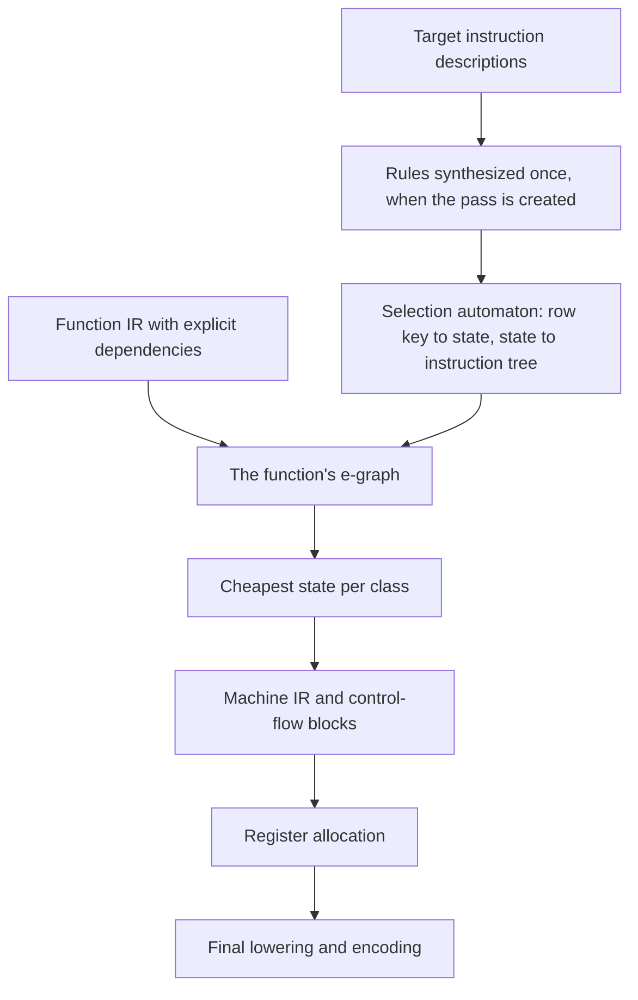

# Instruction selection

A compiler must turn a program's computations into instructions that a processor
can execute. Instruction selection decides which instructions express those
computations. The choice depends on the processor, the available instruction
extensions, and the form of each computation.

Even addition presents a choice. A processor may add two registers, or add a
small constant encoded in the instruction itself. A larger constant needs its
own instructions before the addition can use it. More complex instructions can
combine several computations into one.

TIR makes these choices by comparing the meaning of a program with the meaning
of target instructions. It retains equivalent forms of a computation, finds
instructions that match those forms, and chooses a compatible set by cost.
This chapter explains that design without requiring familiarity with TIR's
implementation.

## The input and output

TIR's intermediate representation, or IR, describes computations as operations
connected by values. A region contains part of a program, such as a function
body or a branch arm. Regions can contain other regions. The
[Core IR chapter](core_ir.md) describes this representation in more detail.

The [RVSDG and control flow chapter](rvsdg.md) explains how FCC builds these
regions and how selection turns them back into machine blocks.

Instruction selection works on a function whose data, control, and effect
dependencies are explicit. A data dependency says that an operation needs
another operation's result. A control dependency limits when an operation runs.
An effect dependency preserves required order, such as a store before a load.

The output is machine IR containing instructions for the chosen target. Values
can still use virtual registers, which name values without assigning them to
specific processor registers. Register allocation makes that assignment later.
Instruction encoding eventually turns the instructions into bytes. Full-register copies are
identified from a single assignment in the target instruction's behavior. A copy
constructor may also record its source and destination port names when fixed
operands establish a full-register copy, such as adding zero on RISC-V.
Allocation prefers placing their endpoints in the same physical register,
including copies to or from fixed ABI registers. This preference never overrides
interference or a fixed assignment. After assignment, copies whose current
endpoints occupy the same register are removed. Narrow register views are
excluded because a self-move can still change the rest of the register.



Before selection, the affine pass replaces supported modular address recurrences
with loop-carried values. Dead-code elimination removes the replaced arithmetic.

The selector retains matching complementary branch forms over the same inputs.
Recovery records edges that continue a loop, so machine emission can branch
back conditionally and let the exit fall through. Edge copies stay on their
original path; the existing block layout pass places their transfer blocks.

After control recovery, dead-code elimination removes unused selected values.
The machine dependence graph also records which instructions read each physical
register definition. A definition overwritten in the same block can disappear
when all its readers have disappeared. Every final register write remains
observable, so this local cleanup preserves values needed in successor blocks
and at function exits.

Target preparation also matters. For example, unsupported integer widths need
legalization into computations the target can handle. Calls and returns need
the target's calling convention, which specifies how arguments and results
travel between functions. Semantic pattern matching is part of this larger
lowering process.

## Intrinsic expansion

Operations such as `ptr.memcpy` and `ptr.memset` retain their meaning through
mid-end optimization. They implement `Intrinsic::expand`, which chooses an
implementation using scoped `TargetEnv` facts and the ordinary `Context` rewrite
APIs. The `lower-intrinsics` pass dispatches through this interface using the
existing pass walker. It visits nested modules too, and runtime declarations
belong to the nearest enclosing module.

Expansion runs before symbol-address materialization, integer legalization,
and instruction selection. It can introduce runtime declarations as well as
ordinary arithmetic and memory operations. Memory runtime calls carry
`resources ["memory"]`, so expansion does not introduce an FP-environment effect
that the original operation did not have. Calls without a resource summary
retain their conservative effects. Expansion must remove its intrinsic and
preserve its results and resource dependencies. It emits ordinary operations,
not further intrinsics.

Expansion logic belongs to the operation and is shared across targets. Target
defaults apply where the IR supplies no override. Backends report legal unaligned
scalar memory widths. Absent those facts, expansion uses byte accesses. The
x86-64 and AArch64 backends report widths of 1, 2, 4, and 8 bytes. RISC-V retains
the byte-only default because wider unaligned accesses can trap.

Memory expansion recognizes these `target_env` entries:

| Entry | Meaning | Default |
|---|---|---|
| `memory_scalar_bytes` | Additional legal unaligned integer access sizes, powers of two up to 8 bytes | None beyond byte accesses |
| `memory_copy_bytes` | Additional legal unaligned bit-copy access sizes, powers of two up to 16 bytes | None |
| `memory_inline_bytes` | Maximum constant copy or fill size considered for inlining | 64 |

A constant copy uses the widest legal accesses that fit entirely inside its
range. Its final access uses the smallest legal width covering the remaining
bytes, placed at the end of the range. This may repeat destination bytes, which
is valid because memcpy has disjoint source and destination ranges and no
volatile or atomic semantics. For example, a 31-byte copy can use two 16-byte
pairs at offsets 0 and 15. x86-64 with SSE permits 16-byte copies through its
packed load/store
instructions. These widths do not enable wide integer arithmetic or fills.
Wide register spills reserve the register's full size at the ABI slot alignment;
x86 uses unaligned packed moves for those slots. A constant fill repeats the byte
across each stored integer. Expansion also requires at most eight chunks:
each copy chunk emits one load/store pair,
and each fill chunk emits one store. This bounds the number of memory accesses
on byte-only targets as well as wide-access targets. For example, a byte-only
target inlines at most eight bytes; an eight-byte-access target can inline
64 bytes; a 63-byte copy uses eight chunks with its last access at offset 55.
This is a code-size bound, not a calibrated target cost model.

Zero-length operations forward their incoming memory state without accessing
memory. Dynamic sizes and copies or fills exceeding either budget use a runtime
call.

## A shared language for computations

An IR operation has a semantic description of its result and effects. Integer
addition describes an addition of values with a particular width. A memory
operation also describes its relation to memory state.

Target instructions have semantic descriptions too. TIR's machine description
language, TMDL, records instruction behavior alongside operand and encoding
information. The compiler derives selection patterns from that behavior.
See the [TMDL overview](../tmdl/index.md) for the machine description language.

For example, a RISC-V add-immediate instruction adds a register value to a
sign-extended constant. Its semantic pattern describes the addition, while its
operand constraints require a constant that fits the instruction's immediate
field. An immediate is a value stored directly in the instruction encoding.

Using the same semantic vocabulary connects the two descriptions. A target
instruction can match a computation even when the IR expresses it through
several operations. The selector still checks operand constraints. Equivalent
arithmetic alone does not make an encoding legal.

## Rules are synthesized once

Matching a target's thousands of patterns against every function is work the
compiler would repeat for each function and each compile. TIR does that work
once, when the selection pass is created, and keeps its result as a table of
rules. A function then pays only for looking its rows up in that table.

Synthesis starts from the dialects the context holds. Every operation with
semantics is instantiated at each integer width the target computes in, at
each floating-point format, and with a pointer where it takes an address; a
memory access is instantiated at each width it moves. Each instance is an
operation whose operands are placeholders, and each variant of an instance
holds one operand constant.

A vector operation is instantiated once per element width, with the lane count
left open. A function may compute in `vec<4xi32>` or `vec<8xi32>`, and no list
of lane counts exists when the pass is created, so the count is not part of
the instance. The element widths come from the target's patterns: a pattern
that cuts a register into a number of lanes it is told, as the RISC-V vector
instructions do through `vl`, admits the element width it names, or every
whole number of bytes where it is told the width too. A target with no such
pattern gets no vector instance. The instance's type is the vector of that
element with no lane count. An operation with a length operand reads its count
there; one without names the operand it lacks, which stands for the lane count
of whatever type a row computes at. Operands and result of an elementwise
operation are one vector type, which the operation verifies, so no instance
mixes element widths.

A function's row matches such an instance because the lane count is not in a
row's label either. The seeder labels a row of `vec<4xi32>` with the vector of
`i32` at any count and gives the row one more child after its values, the
64-bit constant four, which is an offset of that width's zero class like any
constant. A length operand sits in the same place, so an operation given the
constant length four and an operation of a four-lane type are one row. The
instance without a length operand is described with that child, and its tree
reads the count there (`Accept::lanes`).

Synthesis produces one list of rules. A rule's left side is a small graph of
instance rows, the row it rewrites first. Each operand of a row is one of four
things: an operand of the rule read from a register, an operand of the rule a
constant defines and an immediate field holds, a literal the rule names (`inc`
is an add of the literal one), or another row of the rule. An operand or a row
named at two places is one value read twice, as the address of a
read-modify-write is. A rule's right side is the instruction tree, the tree's
cost (latency times sixteen plus bytes, summed, with the constants it reads
from registers built), the field of each immediate, which of the last
instruction's values the root row is (x86 `idiv` gives one rule for the
quotient and one for the remainder over one instruction), and whether the root
row reads or writes memory. A rule whose value a conditional branch tests also
keeps the tree branching on it and the tree branching when it is false.

The forward pass finds the rules of one row. It lowers every instance to its
semantic graph three ways: over registers, with each integer or pointer operand
an immediate, and with that operand each literal the target's patterns and the
shared axioms name as a value under the instance's operator. No list of
literals is written by hand. It saturates the graph with the shared axioms
(`core/defs/isel.pdl`), matches the target's patterns into it, and covers each
root with the cheapest tree of instructions, by the declared costs. Equivalent
forms stay available in that graph, so a target instruction matches a
computation however the IR spells it, but the search runs over the instances,
never over a function. A left side with an immediate also takes the tree
ending in each other instruction of its class, because that instruction may
encode constants the cheapest one cannot. A row that is one of its own
operands, or a constant whatever it reads, becomes a rule with no instruction.
Patterns that build a constant from an immediate become the target's
builders. The branch on a compare is the cheapest branch instruction in the
compare's class, and its inverse is the branch in the class of the
complementary comparison over the same operands.

The backward pass finds the rules of several rows. It tiles every pattern
that has more than one operator top-down with instance rows, up to four rows:
a node of operator F takes a row whose head is F and whose operand types fit,
a symbol is an operand of the rule, a constant is a literal of the row, and an
operator child takes its row next. A symbol or a subterm the pattern spells
twice is read twice. A pattern that adds a displacement to an address is tiled
a second time as its zero form, the sum read as its other operand, so a
sign-extending load whose only form takes an offset still folds the extension
of a load from a bare address. A row of a tiling that holds a literal is also
tried as every row the pool proves equal to it, a multiply by four where the
pattern shifts by two. The left side of each axiom is tiled the same way, at
the axiom's own length: `cmpi (andi (xori a, b), 255), 0` is one 8-bit compare
on x86-64. Where an axiom's right side is one operator over variables alone,
the rows spelling its left side are also a tile for that operator in a pattern:
the variables are bound to the pattern node's children, which are tiled as
usual, and only the rows beneath count against the four. The mask form of a
select is the tile of `If`, which is how `cmp` with `cmovcc` on x86-64 and
`cmp` with `csel` on AArch64 are found, as rules of six rows. The pass lowers each distinct left side as one term, saturates once
more, and covers each as the forward pass does. No rows are paired blindly:
every left side comes from a pattern or an axiom.

Pruning then tries the rules by row count and by cost ascending, and keeps a
rule unless the rules already kept compute its left side at no more than its
cost. That one test drops a duplicate (the same left side after the rows are
put in walk order, the operands numbered by first use and commutative operands
ordered), a composite whose parts together cost no more, and a literal that an
immediate field holds as cheaply. A rule whose field holds constants a cheaper
rule's field does not is kept, and so is a rule whose branch is cheaper than
the branches of the rules that would compute it, such as `test` and `jcc` for
a compare with zero.

Synthesis starts when the pass is created, once the target has configured it,
and runs on a thread of its own beside the front end and the mid-end. The
first function selected joins the thread. A pipeline joins it in a step of
its own, `instruction-select-synthesis`, so `TIR_TIME_PASSES` reports what
was left to wait for apart from the time of `instruction-select`. The thread
also builds what a first saturation would build lazily and no function
decides (`Rules::warm`, `Engine::prepare_rules`): the search orders of every
generated rule, what its atoms resolve to in the vocabulary, and the tries of
the tables for each order. A driver that wants the overlap creates the pass early
and hands it to `lower_and_emit`, as `fcc` does before it parses. A pass that
never selects a function leaves the thread detached, and a panic on the
thread resumes in the function that joins it.

On that thread the pattern rules are matched against the pool by rounds whose
searches run on several threads (see "Relational queries drive matching" in
the instruction combining chapter). The rules' guards ask what a type means
to an instruction and what carrier its values have; both are read off the
context into tables indexed by type before each saturation, so a guard reads
no context and the searches share nothing but the frozen graph. The matches
are applied on the synthesis thread in rule order, which keeps the rules the
same whatever the thread count.

Creating the pass instantiates the operations on the caller's thread. That
interns the types, attribute names and operation names the rules refer to, so
their ids are fixed before the thread starts. The thread then works in a
frozen context, which shares the registry and interns nothing: an id says in
which order the registry met things, and two threads interning at once would
number them by their race. The numbers the automaton stores therefore mean
the same in the function's context and do not depend on how the thread raced
the front end. Should synthesis ask for a type or a name the registry does
not hold, the thread stops, and the function that joins it synthesizes the
rules in place; `TIR_ISEL_SYNTH` names what it stopped at.

A function whose data layout changes the pointer width has the rules
synthesized again, in place, in the same step.

## The selection automaton

`core/src/backend/isel/automaton.rs` turns the rule list into tables. A
pattern is a prefix of some rule's left side: one row's label over the patterns
of its operands. Rules that share a prefix share its pattern, so one step per
row of a function matches every rule at once.

Every operand's class holds a chain that says what state the operand is in,
and the states are numbered in one space. The seeds come first. `REG(type)` is
a value of that type in a register, a pointer as the opaque pointer and a
vector as the vector of its element at any lane count. `CONST(width)` is the
zero of an integer or pointer carrier that wide: a constant is the reference to that zero
at the constant's value, so a step tells the constant five from a register at
offset five. The patterns are numbered after the seeds, in the order the rules
first spell them, which is the order of the rule list and does not depend on
how ids were interned.

The tables are keyed by label ids of the pass's vocabulary
(`tir_egraph::Vocabulary`). Synthesis builds the vocabulary: it interns the
label of each instance the rules name exactly as the seeder builds it for a
function's row (`IrOp::of` and `SemNode::seeded_as` for an operation, the
access term for a read or a write), so the label carries the laws and the
commutes bit a function's row has, and it interns the chain label `st(P)` of
every state and the form label of every pattern. A label types every pointer
as one type, whatever it points at: label identity in `core/src/sem/node.rs`
leaves the type out where the carrier is a pointer's, for instcombine as for
selection. The synthesis thread returns the vocabulary with the tables; the
pass owns it from the join on and lends it to each function's graph. A row's
word `L` is its label id, and an operand's word `T` is the label id of the
chain its class holds, which a rule reads as a cell of the chain's row.

A function's graph stores no row for an add of a constant: the sum is the
reference at that offset from its operand's class. The tables follow it. A
folded row that adds a constant disappears into its reader, whose child becomes
the base's state with the constant as its offset. A rule whose root adds a
constant to a register has no row to step on; it becomes an adder, the builder
of a register at an offset no field of the reader holds (`add r, imm`,
`lea base+disp`, `inc r`). The rule of one row that adds two registers is an
adder as well as a pattern. It admits any offset, and its tree reads the
offset from a register that the builders of constants fill (`Adder::built`).
A rule whose root subtracts a constant from a register is an adder too, at
the offsets whose negation its field holds, and the commit encodes the negated
offset (`Held::Negated`): `x - 8` on AArch64, whose add holds no negative
immediate, is `sub` with the immediate eight. The label says which operand an
addition moves the other by, and a subtraction moves it back by, so no adder is
found by an operation's name. Three kinds of rule stay out of the tables: one
that folds a row subtracting a constant, which the graph holds as the addition
of the negated one; one whose root adds a constant to another row, such as
`lea` of an index and a displacement, because the sum is that row's class at
an offset and no register holds the row yet; and one over an offset of an
offset.

The tables are relations of 32-bit cells (`tir_relational::Words`), one per
number of children `K` the labels have, memory terms with four and five among
them:

- `step[K]` holds `(L, T1..TK, m1..mK, P, c)`: a row with label `L` whose
  children are in states `Ti` at offset classes `mi` is pattern `P`. `c` is the
  row's carrier, which its form gets, so a reader holds the form at an offset
  the way it holds the row's value at one.
- `step_effect[K]` holds the same for a pattern a reader folds a memory access
  through. Such a pattern is a different one from the access selected alone,
  because it holds only where the reader is the access's one reader, in its
  region.
- `step_over[K]` holds the same for a pattern with a folded access in some
  child. `carried[P]` has a bit per such child.
- `effects[K]` holds `(L, s, w)` for a label that is a memory access: child `s`
  is the state it observes, and `w` is one for a write.
- `step_tied[K]` holds the same for a pattern that reads one value at two
  places. `ties[P]` lists those places as pairs of paths through the form's
  children.
- `imm[K]` holds `(L, T1..TK, i, m, W, add, sub, h, sgn, b, align, nonzero)`:
  the classes of offset that the transitions on a key have at child `i`. An
  offset `d` is of class `m` where `x == x & ones(b)` for
  `x = (d + add - sub + ones(h) + sgn) & ones(W)`, `d & align == 0`, and
  `d != 0` if `nonzero`. A signed field of `b` bits has `h = b - 1` and
  `sgn = 1`; a literal `v` has `sub = v` (or `add = -v`) and `b = 0`. Class
  zero is any offset and belongs to a child read from a register.

A field that holds the offset of a register splits an offset it cannot hold
whole. Its `imm` row admits any offset, and `children[P]` keeps the cells of
the field. The field holds the part of the offset that agrees with it in the
field's bits, and the instruction reads the register at the rest:
`load(p + 5000)` on RISC-V reads `p + 4096` at displacement 904, and the
scaled AArch64 load reads `p + 4` at 4096 for `p + 4100`. The form pays for
the rest as for any offset no field holds. A field that refuses zero, the
offset of a folded row and a constant operand are not split.

The classes of one child are not ordered. A rule that joins `imm` gets one row
per class the offset fits, steps once for each, and the extraction keeps the
cheapest tree accepted. The scaled AArch64 load holds an unsigned multiple of
the access size and the unscaled one a signed nine-bit offset; a displacement
both hold steps to both.

A child a rule reads from a register may be a constant in a function, which is
then built into a register. Each such child steps under `CONST(width)` at class
zero too, to the same pattern. That holds for a child of an integer or a
pointer type and for one of a type the semantics read as bits, the rounding
mode among them. A float child steps as a register only. A row of a commutative label is entered in one
order: the engine reads such a row with its two children either way.

A folded child is read at offset zero, or at an offset a field of the pattern
holds, as the displacement of a read over a folded index. No register holds a
folded row, so nothing could add another offset to it. `and(x, load(p) + 5)`
therefore reads the load from a register.

The other tables are indexed by state. `field[P]` has a bit per child whose
offset a field holds. `children[P]` has the state of each child, which names
the adders that can move it. `accept[P]` is the tree of the cheapest rule whose left
side is `P`: the instructions, what a reader of the row reads, the cost, the
result the row is, and for each operand of the rule the path to the form child
that holds it and how: read from a register, the base of a held offset, the
held offset, or a constant. A pattern that is only a prefix accepts nothing.
`branches` gives a compare pattern its branch tree and the inverse. The
builders of constants are kept beside the tables as the pool made them.

Two instances a function's row does not tell apart, such as a store of a
pointer and a store of a 64-bit integer whose value another row computes, spell
one pattern with one tree, and the pattern is entered once. `TIR_ISEL_SYNTH=1`
lists a rule shadowed by a cheaper one with another tree, and each rule left
out of the tables with the reason.

## Selecting one function

A function is selected on the rewrite driver that instcombine runs on
(`core/src/rewrite`), in a fork of the context, over a graph whose labels are
the pass's vocabulary. `core/src/backend/isel/select.rs` holds what selection
adds to the driver, and `edges.rs` the adapter control recovery asks for
branches.

The seeder reads the function's regions into one e-graph. A value is a
reference, an e-class at an offset, so an integer constant is an offset of its
width's zero class and an addition of a constant stores no row. A gate's result
is the gamma over its arms' values. A memory access is a term over its address,
extent, value and state. `seed::children` says which operand of an operation
each child of its row stands for, and the seeder and the commit both read it.

An operation with the constant interface is a constant of the graph.
`fp.rounding_constant` is the integer code the environment holds, three bits
wide. `fp.constant` is a float literal of its bits at its type. No integer
carrier holds a float, so the literal is a row in a class of its own, and a
reader reads it from a register.

Selection asks the seeder for one more kind of row, which instcombine's graph
does not have. A result the graph cannot describe is no bare leaf: the result
of a call, of an operation with several results or with effects and no
semantics, a state a gate or a loop publishes. It is a row over what its
operation reads (`Kind::Result`), the operands in order and then the results
of the regions the operation holds. The row says nothing of what the
operation computes. Two calls over the same operands are two classes, because
the row is unique the way an input leaf is: which operation it stands for is
its provenance, and its label, the same in every function, holds the index of
the result and whether the operation changes a state. The seeder reads that
off the operation's declared resource effects: an effect that changes a
resource and publishes a state. An operation that declares none and publishes
a state is taken to change it.

Four more places get such a row:

- A value a gate chooses among its arms, or a loop carries out, keeps its
  term (`If`, `Loop`) and gets the row beside it in its class. The value is
  there only once the gate or the loop has run, whatever the arms or the body
  wrote, and the term alone names the values chosen among, not the states.
  This row is hash-consed like the term: it is a function of what it reads.
  A result whose arms agree, or that a loop hands back as it took it, is the
  value agreed on and gets none.
- A state a loop's body changes is read at the head of an iteration through
  a row over what the loop is entered on, so the states inside the body are
  no shallower than the ones before the loop.
- A value the function's module defines, such as a callee, is a row over
  nothing. The seeder never reads an operation outside the function.

- A state a read publishes is the class of the state it observed, unless a
  later read observes what it left, directly or through splits and merges
  of it, as reads inlined from a callee do. That state is a row over the
  state observed, marked like a write's. The later read waits for this one:
  the instruction this one becomes publishes the state the later one reads.

A row has at most five children (`WIDEST_RESULT`), which is as many as the
rules below are generated for. Where an operation reads more, its results
read rows of those values instead (`Kind::Operands`), five to a row, and rows
of such rows where that is still too many. A merge of more than five states
keeps its own row and gets a result row over the bundled states beside it.

The commit treats a result row as the operation itself: the row names the IR
value and nothing is built from its children. Extraction prices it the same
way, as the row alone. A unique node stands for what it names, so the engine
adds nothing for its operands.

Selection then gives every class that some operation or access reads its seed
chain, `c == st(seed)(c)`. The classes come from the engine, as the children of its
rows at offset zero, because the tables key a row by what its operands are and
the IR's values do not list the zero classes or say which classes are read. A
carrier's zero class gets `CONST(width)`. Any other class gets `REG(type)` for
the canonical type of the type fact the seeder raised. A class whose type has
no seed gets no chain, and no rule steps a row over it.

Three facts are said of the classes IR values are. They are lattice columns
the selection registers on the engine (`Engine::add_column`), filled from the
use lists.

- `USES` is the number of operand slots and region results that read the
  class's values, all of them together. Each value's readers are said once
  and the column adds them (`Join::Sum`), so two reads that are one class,
  each read once, are read twice. An operation whose result is the class of
  one of its own operands, as an add of a constant is that operand at an
  offset, is the class and not a reader of it: what reads its result is
  counted there. So `t = load p; store t + 1, p` leaves the read one reader,
  the store. A read still counts as a reader of the state it observes.
- `REGION` is the region the value is defined in. Each region that reads the
  value or names it as a result is said of the class as well, so the fact
  exists only where the value is defined and read in one region: a class
  said two regions holds none.
- `DATA` is said of a boolean: how many of the slots `USES` counts read the
  value from a register. A gate reading its predicate and a loop reading its
  repeat predicate do not, because recovery branches there. A class whose `DATA` is
  zero is read only by controls. A wider predicate gets no `DATA`: its case
  tests read the register.

A class may hold several IR values. Two reads of one address in one state in
sibling arms are one class, and so are a value and the arm ports it is
forwarded through. Their regions differ, so the class has no `REGION`.

Two more columns order the accesses. `DEPTH` keeps the greatest value said of
a class and `LIMIT` the least (`Join::Max`, `Join::Min`).

- `DEPTH` is how many writes, one after another, a value waits for at least.
  The rules below compute it. Selection says zero only of a port that carries
  a value in, which nothing computes.
- `LIMIT` is said of a form with a folded access in it: the least `DEPTH` of
  the states those accesses observe.

The order is sound where two things hold of every value: its depth is at
least the depth of whatever it waits for, and a value that waits for a write
is deeper than the state the write observes. The result rows give the first
for what the graph cannot describe. A gate's results read the states its arms
yield, so they are no shallower than a store in an arm. A loop's results read
the states its body yields, which start from the row at the head. The second
holds for a result of an operation that changes a state: it is one deeper
than anything the operation reads, the value a call returns like the state it
publishes. A gate or a loop that publishes a state counts as changing it,
whatever its regions do. The IR hands such an operation the state the reads
before it published, as it does a write, and a read's state is its observed
state's class, so only the extra depth keeps a read ahead of the gate out of
an instruction that reads the gate's result.

A class without a `DEPTH` refuses a fold beside it. What is left without one
is a row with more children than the rules read that is neither a result nor
a merge of states, and whatever is computed from it.

### The generic rules

The rules are generated from the tables when the pass is created
(`select::Rules::of`). No rule names an operation, a pattern or a target.

The first rules say `DEPTH`, and they are saturated alone before the others
(`Rules::order`). A rule that compares a depth reads the value its round
found, so that value has to be final. A rule's head raises a fact with
`HeadOp::Raise`.

```
op(c1..cK) in C, DEPTH(ci) = di, w = changes(L)        => DEPTH(C) >= d1 + w .. dK + w
op(c1..cK) in C, effects[K](L, s, 1), DEPTH(cs) = d   => DEPTH(C) >= d + 1
```

The first runs over the rows of operations, accesses, constants and results,
for `K` from zero to five. `w` is a field of the row's label: one for a
result of an operation that changes a state, zero for every other row. A row
without children has depth `w`. The rule needs the depth of every child, so
a row over a value without one has none. It passes over the term of a gate
or a loop, because the result row beside the term reads everything the term
reads: a class then gets its depth from one row and is said once. The second
is generated per place `s` a write observes its state at.

The rounds are as many as the longest path of rows a value waits through,
since a round carries a depth across one row. A function that is one long
run of calls and stores takes a round per row of that run.

Then, for each number of children `K` that some row of the tables has, there
is one rule per table:

```
op(c1..cK) in C              any label of K children, its id L bound on the row
ci == bi + di                the operand as a base class and an offset
st(Ti)(vi) in bi             any chain of the base, its label id Ti bound on the row
step[K](L, T1..TK, m1..mK, P)
imm[K](L, T1..TK, i, mi, W, add, sub, h, sgn, b, align, nonzero)   for each i
di fits the class mi         three comparisons over the cells of the imm row
=> wi := vi + di
   f  := form(P)(w1..wK)
   C  == st(P)(f)
```

`L` and each `Ti` are cells of rows of the graph, so the executor joins the
row atoms with the two tables. The fit test is the one the `imm` cells spell,
computed by the query's expressions. A register operand binds its seed chain,
so `vi` is the class itself. A constant binds the seed of its zero class with
the value as the offset. A folded row binds a chain an earlier round inserted,
so `wi` is that row's form. The rounds are as many as the deepest rule tree
plus the one that finds nothing.

The rule over `step_effect[K]` is the same with two more atoms, the `USES` and
`REGION` facts of `C`, and the test that `USES` is one. It runs on the access
row and inserts the chain a reader folds the access through. A fact a class
does not hold fails the atom, so the chain exists only where the access has one
reader and is defined and read in one region. Twin accesses in sibling arms
are never folded, whatever reads them. The rule also reads `effects[K]` for
the child that is the observed state and raises `LIMIT` of the form to that
state's `DEPTH`.

The rule over `step_over[K]` is generated per set of children that hold a
folded access. It reads the `DEPTH` of every child's value class and the
`LIMIT` of each such child's form, and tests that no other child is deeper
than that limit. Its head raises `LIMIT` of the new form to the limits it
read. So `r = op(load(p, m0), x)` folds the load only where `x` waits for no
write after `m0`. A tied rule over such children has the same atoms.

A row with a folded access in its form is guarded like the access where a
reader folds the row in turn: its pattern as a folded row holds only where
the row has one reader, in its region (`guarded[P]`). `total += x` followed by
a compare of the sum keeps the add out of the store's read-modify-write tree,
because the add has two readers.

A pattern of `step_tied[K]` reads one value at two paths of its form. The
patterns are grouped by their pairs of paths and by the number of children of
each form on the way to them, and each group gets one rule. The rule adds a
form atom for every form a path passes through, names the base of the two
references with one variable, and tests that their offsets are equal. A small
table generated beside the rules says which group a pattern belongs to.

### Cost

`Select::price` is the cost the driver extracts by. A chain costs the tree its
pattern accepts, and the top price where the pattern accepts nothing or is a
seed. A chain in a class whose `DATA` is zero costs the branch on it instead:
the `branches` entry of its pattern where the pattern's form holds no access
(`carried[P]` is zero), and otherwise its tree and the branch that tests a
boolean in a register (`edges::Cases::tested`). So a
compare only controls read is extracted by what its branch costs: `cbz` on
AArch64 and not `cmp` with `b.eq`, and on RISC-V `blt` over a built constant
where the result of `slti` would have to be tested.

A form pays for each child no field of the pattern holds: the builders
`pool::plan` chooses for a constant's bits, and for a register at a non-zero
offset what `Select::sum` answers. `sum` takes the state of the register and
the offset. It prices every adder of that state whose class admits the
offset, the one that reads the offset from a register with the builders of
that offset added, and keeps the cheapest. Two adders, one over a part of the
offset its field admits and one over the rest, replace it only where they
cost less. The parts tried are the one that agrees with the offset in the
field's bits and the field's value nearest the offset. `2048` on RISC-V is
`addi 2047` and `addi 1`, which cost less than `lui`, `addi` and `add`. A
field that holds part of an offset leaves the rest to the same answer. A
carrier's zero class costs
nothing, so a constant a field holds is free. A constant no carrier holds
costs its builders plus the move into a float register. An operation
synthesis made no instance of, such as a call, an alloca or a symbol address,
stays the operation it is and costs nothing, and so does a result row. Any other row costs the top
price. A class extracted at the top price is uncovered, and `Select::covered`
fails selection with `<dialect>.<op> has no instruction: <the operation>`.

The extraction is a tree cost: a value two operands of one row lead to is
counted under each, so the cost of a state doubles with every access that
reads it beside the write that follows. The top price means only that a
member has no spelling. A sum of prices too large to add is the largest cost
below it (`tir_relational::extract`), so a long run of statements keeps its
spelling. The members of a class that reach that cost tie, and the first in
scan order is chosen: past about sixty dependent statements the chain inserted
first wins, which is the one over registers, and a fold a later round found is
not preferred.

### The commit

The driver's commit walks the regions, outermost first, and hands a value's
readers the spelling of its class. Selection is a `Rewrite` of its own,
`select::Commit`, which wraps the rules and the cost with what the commit
emits. The driver asks it for its `RuleSet`, the price of a node, and through
`spell` for every reference a reader wants written. Beside those it keeps one
hook of the region walk, `rewire_op`.

`rewire_op` rewires an operation the rules replace by demand. A value of it is
handed its spelling where an operation that stays reads it or a region names
it as a result. An operation that changes a state is spelled whether or not
anything reads it. Every other value is spelled by the tree of whatever reads
it from a register, so a row folded into its reader is emitted once, inside
that reader. An operation is replaced where the rules were synthesized for its
name, or where it is a constant. The commit names the IR value each spelling
is of: the value of the operation `rewire_op` rewires, and for an operand a
tree reads from a register the operand of that operation. Twin operations in
sibling arms are one class and one chain, and each is rewired in its own
region from its own value.

The driver places what a spelling writes. It records each written operation
with the operation that defines the named IR value, where both are in one
region, and after the walk of a region gives the written operation that
operation's place in the region's order (`Driver::place`). A tree a reader
demanded therefore sits where the operation it covers sat, not at the reader.
Recovery and the block linearizer break ties between independent operations by
this order, so a value computed ahead of a call in the IR is computed ahead of
it in the block.

A value a control branches on is rewired by what reads it. A control branches
on a value where the chain extracted for its class has a `branches` entry and
its form holds no access (`Commit::tested`). A gate reading the value as its
predicate and a loop reading it as its repeat predicate keep reading the IR
value. The operation that defines it stays in its region, and its operands
become the registers the branch reads, in the order `Commit::slots` names
them for the entry's two trees. No instruction computes the value for these
readers. Whatever reads the value from a register, a result of a region
included, is handed the spelling of the chain as usual. The instruction that
computes it then follows the operation that stayed (`Emitted::implicit`), so
the operation is kept beside it and recovery finds the branch from either.
The driver's memo holds the value of the operation that stayed as the
spelling of the chain's form, which no instruction spells. A twin whose
region can read that value hands its controls the same value and goes, so
two gates on one compare read one predicate.

A row that stays, such as a gate's, may be several alike operations. Its
reader reads the value it names where the region can read that value.

`spell` writes a chain `st(P)(f)` as the tree `accept[P]`. It reads the
children of the chain and of its forms and nothing else of the graph's
selection rows:

- Each operand of the rule is at a path of the form, `accept[P].operands`. An
  operand an instruction reads from a register is materialized by the driver,
  at the type fact of its class: the child itself, or for a base the child's
  class at offset zero. An operand an instruction encodes is the child's
  offset where the field holds an offset, and the constant the child is
  otherwise.
- Each step of the tree is emitted by `Emitter::emit` with those bindings.
  What an earlier step defines is bound for the later ones. A literal the tree
  names is encoded, or built where the instruction reads it from a register.
- The row's value is the result `accept[P].port` of the last instruction, the
  operand the row is, or the constant it is, as `accept[P].value` says. A
  write's value is the state its instruction publishes.

The instructions go into the region of the operation the root row was seeded
from where the reader sees that region, so a value computed ahead of a gate
stays ahead of it, and into the reader's region otherwise.

An instruction that defines several values is emitted once. The quotient and
the remainder of a division are two patterns with one tree, each with its own
form, so the emission is remembered by the rule of the tree's last
instruction and the operands it was bound to. The last instruction is asked
for every result, and a later chain over the same operands reads its own.

A reference that is no row is `spell`'s to write as well. A constant a carrier
holds is built by the automaton's builders, a float by its bits moved through
a form of `floats`. The builders are the plan `Select::plan` answers, the one
the price read: `Builder::builds` admits a builder where it builds the
constant's width and its result register holds that width. The builders are
listed cheapest first. One that adds to a register or shifts one builds only
the widths at which synthesis kept its instruction alone for a row over a
register and a constant, so on RV64 a 32-bit constant is finished by `addiw`
and never by the 64-bit `addi`. Such a builder adds at its own width
(`Builder::bits`): the part left for the builders before it is the one whose
sum with its immediate is the constant there. A reference at an
offset no field held is the class's row moved by the adders `Select::sum`
answers for the seed of the reference's type, the ones the form was priced
by. Without a builder or an adder `spell` leaves the reference to the shared
commit (`Commit::builtin`), which writes the IR constant or addition, and the
end of the commit reports it.

A constant no carrier holds may share its class with a value that carries it,
as a loop's port does. That value costs nothing and wins the extraction.
Where a reader cannot see it, `spell` builds the class's constant.

#### State ports

Memory order is the mid-end's. An emitted instruction takes over the states of
the IR operations its rows were seeded from, read from the IR as it stands
when the instruction is emitted:

- The source of the root row is the operation that defines the value being
  spelled. An operation whose value is in the class of one of its operands,
  as an add of a constant is, is an offset and no row, so the source is the
  operation behind it. The source of a row folded at a child of a form is
  found the same way from the operand that child stands for. No row's
  provenance is read, because one row is every twin of its operation.
- An operand may no longer be the value the row was seeded over. An earlier
  rewire handed the operation the spelling of that value, as it does for a
  truncation that emits nothing and is its operand's register. The child
  stands for such an operand where the driver's memo says the child was
  spelled as it.
- A row of two children matches in both orders where its operator commutes,
  so a form may hold them exchanged. The commit takes the order in which each
  child is the operand it stands for: a reference to the operand's class, or
  the form of the row the operand refers to.
- A step threads the states it names past its form's own operands. Each such
  argument is a state child of some form of the tree, and the step takes the
  ports of that form's source. A source no step names goes to the last step.
- Within one step, a state one source publishes and another observes is
  dropped, as for a load and the store that follows it. Its readers are handed
  the state the first one observed.
- Within one step that covers a write, a read of the same resource is no
  port. The instruction observes what the write observed and publishes what
  the write published. The readers of the state the read published, such as
  a join of several reads that the write observes, are handed the state the
  read observed. `*r += a[i] * b[i]` is one instruction that observes the
  join, and the join reads the body's entering state in place of the read's.
- A tree of no instruction, such as a write the target hardwires, takes no
  port. The readers of each state its sources published are handed the state
  observed, and a write's value is that state.
- The instruction publishes states of its own, and the readers of each state a
  source published are handed the new one. The IR is the only record: the
  next access reads its operand, which is the new state by then. The ports are
  read after the operands are spelled, because an operand emitted just before
  took the readers of the state it published.
- An instruction with ports sits in its source's region. Where the reader
  cannot see that region the chain has no spelling.

A chain is refused, with the reason under `TIR_ISEL_TRACE`, where a source's
states were taken already, and where its tree reads memory and the value being
spelled leads to no source.

The end of the commit (`Commit::finish`) hands the readers of every replaced
read that got no instruction the state it observed, sweeps what nothing
demands, and fails on a replaced operation that is still there, printing it
as written.

## Branches and recovery

Control recovery turns the regions into blocks and asks the adapter in
`core/src/backend/isel/edges.rs` for each branch. The adapter reads the
automaton's `branches`, the graph and its extraction, and what the commit
recorded (`select::Emitted`):

- `types`: the source type of each value an instruction defines or reads;
- `literals`: the integer each built literal holds;
- `implicit`: the instructions each instruction implicitly follows.

A control whose predicate is defined by an operation the commit left for it
gets the branch of that operation's class. The adapter takes the class of the
predicate from the driver, the chain the extraction chose for it, and the
`branches` entry of the chain's pattern. The operands come from the chain's
form (`Commit::slots`): a constant a field holds is read off the form, and a
register is the next operand of the operation that stayed. A predicate an
instruction computes leads to the same operation through
`Emitted::implicit`. The branch tree is emitted into the block over those
operands, after the block's bindings, with the taken block bound. The control
reads the registers and not the boolean (`Edges::control_reads`). Recovery
renames the operands of an operation as it places it, so the adapter keeps
what each such operation read when it was first asked. Once the blocks exist,
`Commit::branched` erases the operations that stayed, which nothing reads.

The branch goes to the edge on which its compare holds, and the other edge
falls through. Where the outcome recovery asks about is the compare not
holding, the two edges change places. The inverse entry is used for one
purpose: where the edge on which the compare does not hold continues a loop
(`Edge::loops_back`) and the other does not, the inverse branches back and
the exit falls through. A taken edge that carries arguments goes through a
block of its own. A predicate the commit built as a literal decides its
outcomes without a test.

Any other predicate is tested through the same table. When the pass is
created, the operation generic recovery builds to test a case
(`destructure::case_test`, equality with the case) is matched to the instance
synthesis made of it at each integer width, and the label of its row is kept
per seed. `edges::Cases` lists, per seed, the patterns with that label and a
branch: the ones whose field holds the case (`field[P]`), with the field's
class, cheapest branch first, and then the compare of two registers. A
switch's case takes the first pattern whose class the case fits, so the case
is an immediate wherever a field holds it and is built in the block only
otherwise. A boolean that is no compare is tested for zero through the same
list, and the branch on it is the inverse of that entry, so it goes where the
boolean holds.

Each block is then ordered by its machine dependences, which include the
registers an instruction names without a value, such as the flags between a
compare and its branch. The score counts every recovered instruction once, so
a pass comparing semantic alternatives can read it. Adoption publishes the
staged function.

Recovery orders the default arm of a wider predicate last and reaches it by
falling through the tests of the named cases, so the adapter is asked for
equality tests only. A default outcome it were asked to test has no entry:
the table holds the test for equality.

Three limits remain. A compare of a masked value with zero is one flag
instruction and a branch (`test` with `jcc`, `tst` with `b.ne`), derived from
the instruction's flags like any other compare. A bare boolean does not bind
it: the instruction reads its register whole, and only bit zero of a boolean's
register is defined, so the test is `and`, `test`, `jcc` on x86-64, and
AArch64 builds the mask in a register. `DATA` counts the
complement of a boolean (`xori` with one) as a reader and does not follow a
boolean through a gate's result or a loop's port, so such a compare is priced
and computed as a value and its complement is tested as a bare boolean. An
emitted instruction joins its region behind every gate and loop the region
holds, and recovery routes a branch past a gate only where no computation
lies between the two.

## Small and large constants

Consider a 32-bit addition of `x` and `5` on a 64-bit RISC-V target. The constant
fits an immediate field. Selection can choose `addiw`, which performs the word
addition with the constant in the instruction. No instruction needs to put `5`
in its own register.

Now consider a 64-bit addition of `x` and `2048`. RISC-V's signed 12-bit
add-immediate field represents values from `-2048` through `2047`. Encoding
`2048` there would change its value, so that immediate match is illegal. The
selector adds the field's extreme and what is left in two adds where that
costs less than building the constant in a register and adding the registers.

A constant in a register is built by the materializers synthesis found: a
pattern with one immediate whose result scales with it takes the bits its
field holds at that scale, a pattern with no other operand matches when it
reproduces the constant exactly, and a pattern with a register operand as well
demands the rest of the constant there. A pattern that complements its
immediate builds the constants whose complement fits the field, and one that
replaces a field of a register builds a constant one field at a time, the
highest first, over zeros or over ones, whichever takes fewer instructions.
`2048` on RISC-V is `lui` and `addi`,
and a 64-bit constant becomes a chain of `lui`, `addi` and `slli`; on AArch64
`65536` is `movz` and `movk`, and `-1` is one `movn`. The exact
sequence changes with the available target features and costs; every immediate
fits, and the sequence computes the original value. At one cost a pattern whose
immediate is the constant itself goes first, so zero on RISC-V is `addi` from
the zero register and not `lui`. A pattern that names the width it computes at
builds constants of that width only and goes before an unnamed one, so a
32-bit constant on a 64-bit RISC-V target ends in `addiw`.

LLVM input conversion retains binary-operation no-wrap flags. A sign extension of an `add nsw`
or `sub nsw` with a constant operand can be expressed as wider arithmetic on
sign-extended operands. The constant is interpreted at its source width first.
Other uses retain the narrow operation; unflagged and unsigned-only arithmetic
retain wrapping before sign extension. GEP conversion scales the variable and
constant parts of these signed additions separately. It adds dynamic offsets
to the base before literal offsets, and returns the base directly for zero
offsets, exposing shared products and displacement addressing to selection.

Frames use the stack pointer as their base, so the ABI's optional frame-pointer
register remains available for allocation. Its ordinary callee-save obligation
still applies; stack, return-address, and explicitly reserved registers remain
excluded.

Register allocation can replay an immediate producer instead of spilling its
value. Replay sites retain block order so fresh register numbering and allocation
remain reproducible across compiler processes. A target can also identify a symbol-address instruction whose independent
relocation computes the same address at every replay site. x86-64 permits this
for symbolic RIP-relative `lea`; arbitrary numeric PC-relative computations do
not acquire that guarantee from the symbol-address hook.

## After selection

Call lowering snapshots each distinct argument value and register class once
per call, before placing arguments in their ABI registers or stack slots.
Repeated arguments share that snapshot, so their copies do not create
overlapping live ranges proportional to the argument count. The stack
arguments are stored first and the registers the call reads, the x86-64
vector-register count in `al` among them, are written last, so no value the
stores read lives across a register the call names.

Register allocation assigns physical registers afterward. It follows
Buchwald, Zwinkau, and Bersch, "SSA-based Register Allocation with PBQP"
(CC 2011), on the relational engine. Each function gets one engine database:
its blocks, operations, values and rows share one id space. Seeded tables hold
which block holds each operation and at which program point, what each
operation reads and defines, block parameters, edges, branch arguments, copies,
clobbers and pins. Rules derive live-in and live-out sets, one range per block
and value with its start and end as minimum and maximum lattices, the values
in a register after each operation, interference, forbidden registers and
affinities. A range lookup reads the operations of a block whose program point
lies inside a range, so these rules cost what they produce.

Block arguments stay SSA through allocation: a branch argument and its
parameter are joined by an affinity edge, and after assignment each edge whose
affinities were not met gets a parallel copy on the physical registers. The
calling convention enters as pins: an incoming argument is pinned at function
entry and copied into a body value, and each return value is copied into a
value pinned to its return register.

Spilling runs once, before assignment, as Belady per block after Hack and
Braun & Hack: global next-use distances, loop headers taking the values their
loop reads, reloads at uses, one store after the definition, and block
parameters that do not fit become memory parameters. Constants are replayed
instead of reloaded. At an instruction, a register it reads or writes by name
or through a pin counts once beside the values live across it, as section 4
pairs such a register only with an operand or result allowed to take it.
Afterwards, one parallel copy before each constrained instruction splits the
live range of every value live there, with two exceptions: a pinned value the
instruction does not read, whose register is fixed anyway, and a pinned block
parameter the instruction reads. Where the names of a split value meet at a
block that a conditional branch enters, the branch carries no arguments, so
that edge first gets a block of its own that enters through an `asm.vbr`.
Section 4 of the paper then restricts
and relaxes the constraints of the instruction's operands and results over the
hierarchy of register classes. Assignment and copy coalescing share one PBQP
solve, where copies are affinity edges weighted by loop depth. The solver does
not backtrack. It applies the optimal reductions and decides the remaining
nodes in a reversed perfect elimination order: blocks in a pre-order walk of
the dominator tree, each block's parameters and then its definitions in
program order. Where that order first reaches a value of a constrained
instruction, it places all of that instruction's values, in the order section
4 gives them.

Two kinds of value are written twice: the destination of a tied operand, by
its copy and again by the instruction, and an incoming stack argument, an
entry-block parameter that its placeholder load writes again. Each second
write falls inside the range the first one starts, so interference stays that
of strict SSA. For a spilled function in that form whose ranges are split at
every constrained instruction, the order finds a register for every value and
the solve is linear in the size of the graph. The values left whole fall
outside that guarantee; a value the solve leaves without a register fails
allocation. Later target passes can make choices that depend on those
assignments. For example, RISC-V compression can replace an instruction with a
shorter encoding when its actual registers and immediates meet the compressed
form's restrictions.

## Diagnostics

`TIR_ISEL_SYNTH` reports what synthesis found and how long it took, and lists
the generated rules with the steps of their plans. `TIR_ISEL_TRACE` prints, for
each function after extraction, the rows seeded, the seed chains, the chains
and forms the rules inserted, what the classes were extracted as, how the two
facts settled each foldable access, how many of those observe a state with a
depth, how many accesses the extracted trees fold, and every uncovered operation with one row
of it, its operands' states and the reason no accepted chain reached it. During
the commit it prints each chain spelled, with the operations its rows were
seeded from and the step that threads each, and each chain refused, with the
reason. `TIR_ISEL_TIMES` prints one line per function with the microseconds of
the seed, the chains, the facts, the saturation, the extraction, the commit
and recovery. The
rounds and the matches of each are on the `tir-sat` line of `TIR_TIME_PASSES`.
`TIR_RULE_STATS` reports the applications of each rule, and
`TIR_SAT_DUMP` writes the function's graph and rules for the saturation
workload tool.

## What the rules do not yet cover

A tie between an operand and a row folded elsewhere in the chain, and a tree
folding an access below its root's own operands, are not synthesized: the
automaton keys ties between leaves only. A read-modify-write of an address
with a displacement and the mask form of a select need such a tie. A rule's tree encodes its operands' constants as they are, so an
axiom that computes a constant from two operands, or extends a constant
operand, yields no rule. A read
whose copies in two arms are ready at different depths is not folded into a
row that reads another register. An offset is factored only where it is read
from a register, not from a held row. A
gate's arm selects without the
fact its predicate states there. Integer widths a function computes in that
synthesis did not instantiate are not re-synthesized.

A gate's result whose arms agree is the class of the value agreed on, and
that class's depth does not include the gate. Where the commit hands the
reader that value this is right. Where the value has no spelling outside the
arms, as with the same read in sibling arms, the reader stays on the gate's
result and the class is too shallow for it; the commit has no spelling for
that shape either (see "State ports").

A vector pattern that names its lane count by value, as the AArch64 Advanced
SIMD patterns do, matches no instance: the instance's count is open. Keying
the count as a constant a state may pin, the way an operand constant is
pinned, would cover them. Vectors of floats have no instance, and a tree
folding rows of different lane counts would read one count for all of them.
